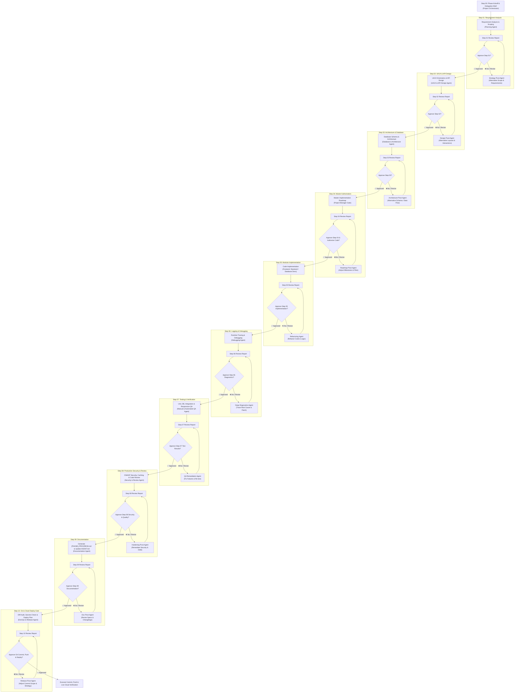

# 🤖 AGENT.md — Full-Stack Continuous Multi-Agent Engineering Protocol

> **Project**: Folioblox AI-Powered Portfolio & Dynamic Content Engine  
> **Master Protocol**: Step-Gated Multi-Agent Software Engineering Loop with Feedback Pivot  
> **Repository**: `Protfolio`  
> **Active Model**: Gemini 3.8 Flash (Medium)  
> **Master Specification**: `AGENT.md`  
> **Phase Progress Convention**: `<PHASE_NAME>_PROGRESS.md` (e.g., `PHASE_1_PROGRESS.md`)  
> **Last Updated**: 2026-11-08  

---

## 📌 1. Operational Directive & New Chat Handshake

Whenever a new chat begins and the user triggers:
- `Next Phase`
- `Continue Development`
- `Start Next Task`
- `Status`

The system must execute:
1. Read `AGENT.md` to establish current roadmap status and active phase.
2. Read the latest phase progress file (e.g., `PHASE_1_PROGRESS.md`).
3. Inspect Git status, branch, and working tree cleanly.
4. Verify whether previous steps/phases were approved or require pending fixes.
5. Kick off the designated step with its dedicated agent and present review for approval.

---

## 🔄 2. Enhanced Step-by-Step Approval & Strategy Pivot Workflow

Every single step in every phase operates with an **Independent Specialized Agent**, a **Structured Review Report**, and an **Explicit User Approval Gate**. 

If the user rejects or requests revisions at any step, the **Strategy Pivot Agent** immediately activates, analyzes the critique, formulates an alternative best strategy, and resubmits for review.

---

## 👥 3. Specialized Agent Directory

1. **Project Manager / Orchestrator**: Runs Step 00 kickoff, manages gates, and keeps steps strictly aligned.
2. **Planning Agent**: Runs Step 01 requirement decomposition, dependency scoping, and edge cases.
3. **UI/UX & Kinematics Agent**: Runs Step 02 visual design, responsive layouts (360px-4K), and a11y.
4. **Database & Architecture Agent**: Runs Step 03 schema modeling, SQLAlchemy dual-engine parity, and modular boundaries.
5. **Full-Stack Development Agents**:
   - **Frontend Dev Agent**: DOM manipulation, live split-screen editor, modal kinematics.
   - **Backend Dev Agent**: FastAPI async routers, Gemini AI parser, controllers.
   - **Database Dev Agent**: Migrations, table schemas, seeders, rollback snapshots.
6. **Logging & Debugging Agent**: Runs Step 06 runtime tracing, log sanitization, error reproduction.
7. **Manual & Automated QA Agent**: Runs Step 07 unit tests, database test suites, HTTP endpoint checks.
8. **Production Security & Review Agent**: Runs Step 08 OWASP security, CSP/CORS headers, Bcrypt/JWT verification, performance audits.
9. **Documentation Agent**: Runs Step 09 generating `<PHASE_NAME>_PROGRESS.md` and maintaining `AGENT.md`.
10. **DevOps & Cloud Release Agent**: Runs Step 10 git diff verification, secret scrubbing, commit/push, and Render/Cloudflare deployment.
11. **Strategy Pivot Agent (Fallback)**: Automatically activates whenever user rejects any step to create a revised strategy.

---

## 📝 4. Documentation Strategy (`____progress.md`)

In **Step 09**, the Documentation Agent generates a dedicated progress file for the completed phase:
- File naming convention: `<PHASE_NAME>_PROGRESS.md` (e.g. `PHASE_1_PROGRESS.md`, `PHASE_2_PROGRESS.md`).
- Master tracking file: `AGENT.md` is updated with high-level phase completion, while the detailed step logs, test outputs, file changes, and debugging history reside in `PHASE_[N]_PROGRESS.md`.
- No historical progress is ever discarded.

---

## 🗺️ 5. Master 8-Phase Roadmap

| Phase | Phase Title | Primary Scope | Status | Phase Progress Doc |
| :---: | :--- | :--- | :---: | :--- |
| **Phase 1** | **Core Foundation & Env** | Auth/Security dependencies, Google Client ID, SMTP, `.env.example`, `requirements.txt` | ✅ **Completed** | `PHASE_1_PROGRESS.md` |
| **Phase 2** | **Database Schema & Models** | `User`, `EmailOTP`, `PortfolioData` tables, migration scripts, dual-engine sync | ✅ **Completed** | `PHASE_2_PROGRESS.md` |
| **Phase 3** | **Backend Security & Mailer** | Bcrypt password hashing, 6-digit OTP engine, async SMTP background delivery | ✅ **Completed** | `PHASE_3_PROGRESS.md` |
| **Phase 4** | **Backend REST API Suite** | 9 Auth REST endpoints (`/api/auth/*`), JWT cookie management, CORS, rate limiting | ✅ **Completed** | `PHASE_4_PROGRESS.md` |
| **Phase 5** | **Frontend UI & Kinematics** | Google 1-click modal, 6-digit OTP UI, dual login tabs, toast alerts, a11y | ⏳ **Active** | `PHASE_5_PROGRESS.md` |
| **Phase 6** | **Split-Screen CMS Editor** | Left Form Editor + Right 1:1 Live Preview, dirty state tracking, auto-sync | 📋 Queued | `PHASE_6_PROGRESS.md` |
| **Phase 7** | **Production Hardening** | Security headers (`_headers`), static asset caching, Gzip compression, rate limits | 📋 Queued | `PHASE_7_PROGRESS.md` |
| **Phase 8** | **Cloud & Live Deployment** | Render web service verification, Neon PostgreSQL connection, SSL & domain checks | 📋 Queued | `PHASE_8_PROGRESS.md` |

---

## 📋 6. Current Execution State: Phase 5

- **Current Active Phase**: Phase 5 — Frontend UI & Interactive Modals
- **Active Step**: Step 01 — UI/UX Modal Architecture & Kinematics
- **Progress Document**: `PHASE_5_PROGRESS.md`
