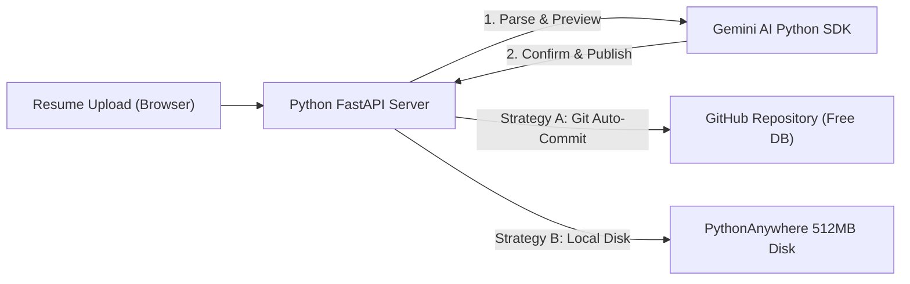

# ☁️ Cloud Hosting & Python FastAPI Migration Plan
> **Document:** `CLOUD_HOSTING_PLAN.md`  
> **Project:** Folioblox AI-Powered Portfolio  
> **Target Stack:** Python (FastAPI) + Google Gemini AI + Free Cloud Tier  
> **Scope:** Free hosting selection, persistent data storage without database costs, Python backend architecture, and step-by-step production deployment.

---

## 📌 1. Executive Summary & Objective

Abhi hamara portfolio **Node.js Express** local server (`server.js`) par chal raha hai aur saara data local disk par (`data/portfolio.json`) save hota hai. 

Hamein do specific goals achieve karne hain:
1. **Backend ko Python (FastAPI) mein convert karna** (cleaner AI SDK, fast asynchronous parsing, typing support).
2. **100% Free Cloud Platform** par live deploy karna jahan:
   - Server 24/7 internet par accessible ho.
   - Resume upload aur AI parsing bina server crash ke chale.
   - **Data wipe out na ho**: Free servers ke restart hone par bhi `data/portfolio.json` aur uploaded resume safe rahein bina kisi paid database (MySQL/MongoDB/AWS RDS) ke.

---

## ⚖️ 2. Free Cloud Providers: Comparative Analysis

Free cloud hosting par sabse bada technical challenge hota hai **Ephemeral Disk (Temporary Hard Drive)**. Jab free server 15 minute baad sleep mode mein jata hai ya restart hota hai, toh local files reset ho jati hain.

Neeche 4 best free platforms ka analysis diya gaya hai:

| Provider | Free Tier Policy | Python Support | Disk Persistence | Verdict & Rating |
| :--- | :--- | :---: | :--- | :---: |
| **Render.com** | • 750 free hours/month<br>• Custom domains & free SSL<br>• Auto-deploy from GitHub | 🐍 FastAPI / Uvicorn natively supported | ⚠️ **Ephemeral Disk**<br>Restart par local file reset hoti hai unless GitHub sync use karein | 🥇 **#1 Recommended (Modern, Fast, Git Sync)** |
| **PythonAnywhere** | • 100% Free forever<br>• No credit card required<br>• Custom Python console | 🐍 Python WSGI / Flask / FastAPI | 🟢 **Permanent 512MB Storage**<br>Server restart par bhi files kabhi delete nahi hoti! | 🥈 **#2 Recommended (Zero-Setup Storage)** |
| **Hugging Face Spaces** | • Free 2 CPU cores, 16GB RAM<br>• Unlimited uptime<br>• Docker / FastAPI template | 🐍 Native Python & AI models | 🟢 **Persistent 50GB Repo Disk**<br>Files git lfs / commit ke through save rehti hain | 🥉 **#3 Strong Alternative (AI Native)** |
| **Vercel** | • Fast global CDN<br>• Unlimited personal projects | 🐍 Serverless Functions (`api/*.py`) | ❌ **Read-Only Filesystem**<br>Local disk par file write allowed nahi hai | ⚠️ **Not suitable for direct file write** |

---

## 🛡️ 3. The Data Persistence Strategy (Data Safe Kaise Rahega?)

Kyunki hum koi paid database (MySQL, PostgreSQL ya MongoDB Atlas paid) use nahi kar rahe, isliye hum **3 Free Persistent Strategies** mein se ek chunenge:



### 🥇 Strategy A: GitHub API as Free Database (Render.com Ke Sath - Best!)
* **Kaise kaam karega:**
  1. Jab aap modal mein **"Confirm & Publish Live"** dabayenge, Python server `data/portfolio.json` ko update karega.
  2. Python script automatically **GitHub REST API** ko call karke updated `portfolio.json` aur naya resume PDF aapke private/public GitHub repository mein commit kar degi.
* **Fayda:**
  - 100% Free, infinite storage, aur version control history.
  - Render chahe 1000 baar bhi restart ho jaye, aapka data kabhi gayab nahi hoga.

### 🥈 Strategy B: PythonAnywhere Built-in Persistent Disk
* **Kaise kaam karega:**
  - PythonAnywhere free tier par pure Linux filesystem deta hai (512MB).
  - Python ka normal `with open("data/portfolio.json", "w")` code direct kaam karta hai aur reboot ke baad bhi data safe rehta hai.
* **Fayda:**
  - Zero external setup, seedha file save karo aur chalao.

---

## 🏗️ 4. Python FastAPI Backend Architecture

Node.js ke Express code (`server.js`, `resume-controller.js`, `parse-resume.js`) ko replace karne ke liye Python directory structure:

```text
📁 Protfolio/
├── 📄 app.py                     # FastAPI Main Application (serves static frontend + API routes)
├── 📁 server_py/
│   ├── 📄 __init__.py
│   ├── 📄 config.py              # Environment variables & constants
│   ├── 📄 resume_parser.py       # pypdf text extraction + Google Gemini 2.5/Flash AI
│   ├── 📄 controller.py          # Staged diff engine, backup creation, atomic JSON writer
│   └── 📄 github_sync.py         # Optional auto-commit to GitHub for Render persistence
├── 📄 requirements.txt           # Python dependencies
├── 📄 Procfile                   # Cloud process starter command
├── 📄 render.yaml                # Optional Render Infrastructure-as-code
├── 📁 data/
│   ├── 📄 portfolio.json         # Main live portfolio data store
│   └── 📁 backups/               # Automated timestamped backup snapshots
├── 📁 uploads/                   # Uploaded resume archive
├── 📁 assets/                    # Static public assets (resume download)
└── 📄 index.html                 # Existing frontend (0 modifications needed!)
```

---

## 🔌 5. Exact Python Endpoints Contract (1-to-1 Frontend Match)

Frontend (`js/resume-uploader.js`, `js/render.js`) mein bina kisi badlav ke ye exact endpoints Python mein banenge:

### 1. `POST /api/upload-resume?preview=true`
* **Input:** Multipart form data (`file: resume`) + Query param (`preview=true`).
* **Python Logic:**
  - `pypdf` buffer se clean text nikalega.
  - `google-genai` (Gemini Flash) ko strict JSON schema ke sath prompt karega.
  - Python `compute_diff(old_data, new_data)` function aamne-samne changes evaluate karega.
* **Response:** `{ success: true, preview: true, diff: {...}, data: {...} }` (Disk par save nahi hoga).

### 2. `POST /api/publish-portfolio`
* **Input:** JSON payload `{ data: {...}, resumeFilename: "..." }`.
* **Python Logic:**
  - Schema validate karega (`validate_and_merge`).
  - Timestamped snapshot create karega (`data/backups/portfolio-TIMESTAMP.json`).
  - `data/portfolio.json` ko atomically overwrite karega.
  - Agar GitHub sync active hai toh commit push karega.
* **Response:** `{ success: true, message: "Published live!", backup: "..." }`.

### 3. Static & Utility Routes:
* `GET /api/portfolio` -> Live `portfolio.json` deliver karega.
* `GET /api/backups` -> Backup files ki list return karega.
* `GET /api/health` -> Server status aur Gemini API key check karega.
* `GET /` -> `index.html` static site serve karega.

---

## 📦 6. Python Dependencies (`requirements.txt`)

```text
fastapi==0.110.0
uvicorn[standard]==0.28.0
python-multipart==0.0.9
pypdf==4.1.0
google-generativeai==0.8.0
python-dotenv==1.0.1
requests==2.31.0
```

---

## 🚀 7. Step-by-Step Implementation Roadmap

| Phase | Title | Exact Technical Tasks | Output |
| :---: | :--- | :--- | :--- |
| **Phase A** | **Python Core Setup** | 1. `requirements.txt` create karna.<br>2. `app.py` mein FastAPI app aur static files mount karna (`index.html`, `css/`, `js/`, `assets/`).<br>3. `GET /api/health` aur `GET /api/portfolio` test karna. | Python server local port 8000 par poori website render karega. |
| **Phase B** | **Resume Parser in Python** | 1. `server_py/resume_parser.py` likhna (`pypdf` text extraction).<br>2. Gemini Flash Python API integrate karna with fallback rule parser.<br>3. `Who Am I` terminal + 6 Skills Showcase categories schema enforce karna. | PDF se 100% structured JSON generate hoga. |
| **Phase C** | **Review & Confirm (Phase 3 in Python)** | 1. `server_py/controller.py` mein `compute_diff` aur atomic file write likhna.<br>2. `POST /api/upload-resume?preview=true` aur `POST /api/publish-portfolio` endpoints wire karna.<br>3. Automated backup snapshots generate karna. | Review & Diff modal Python backend ke sath 100% functional ho jayega. |
| **Phase D** | **Cloud Deployment Prep** | 1. `Procfile` banana: `web: uvicorn app:app --host 0.0.0.0 --port $PORT`.<br>2. Render / PythonAnywhere config finalize karna.<br>3. GitHub repo connect karke 1-click live deploy karna. | Free live URL mil jayega (e.g. `https://matloob-portfolio.onrender.com`). |

---

## 🛠️ 8. Render.com Par Free Deploy Karne Ke Steps (Quick Guide)

1. **GitHub Par Push Karein:**
   ```bash
   git add .
   git commit -m "Add Python FastAPI backend & cloud hosting configuration"
   git push origin main
   ```
2. **Render.com Par Web Service Banayein:**
   - [Render Dashboard](https://dashboard.render.com/) par jayein aur **New > Web Service** select karein.
   - Apna GitHub repository connect karein.
   - Settings set karein:
     - **Runtime:** `Python 3`
     - **Build Command:** `pip install -r requirements.txt`
     - **Start Command:** `uvicorn app:app --host 0.0.0.0 --port $PORT`
     - **Instance Type:** `Free`
3. **Environment Variables Add Karein:**
   - `GEMINI_API_KEY`: Aapka Google Gemini API key.
   - `ADMIN_UPLOAD_PIN`: (Optional) Upload security ke liye passcode.

---

## 🏁 Next Step (Aapko Kya Chunna Hai?)

1. **Abhi Python code (`app.py`, `server_py/`, `requirements.txt`) likhna shuru karein?**
2. Hosting platform preference: **Render.com** (Recommended modern UI) ya **PythonAnywhere**?

