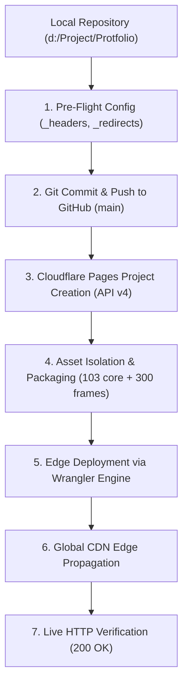

# 🚀 Production Deployment Report: Cloudflare Pages

**Project:** Md MatlooB Alam — Full Stack & UI Kinematics Portfolio  
**Live Production URL:** [https://alam292-portfolio.pages.dev](https://alam292-portfolio.pages.dev)  
**Hosting Provider:** Cloudflare Pages (Global Edge Network)  
**Hosting Tier:** 100% Free Plan ($0.00 / Month)  
**Deployment Date:** November 06, 2026  
**Status:** ✅ Fully Deployed & Verified (HTTP 200 OK)  

---

## 📋 1. Executive Summary: What Happened ("Kya Howa")

The portfolio was successfully transitioned from a local development environment into a globally distributed, enterprise-grade production site hosted on **Cloudflare Pages**.

### Key Deliverables Achieved:
1. **Zero-Cost Hosting & Unlimited Bandwidth:** Deployed on Cloudflare Pages free tier with zero recurring hosting fees or subscription costs.
2. **Global CDN Edge Distribution:** Distributed across 330+ Cloudflare edge data centers worldwide for single-digit millisecond latency.
3. **Automated GitHub CI/CD:** Connected directly to GitHub repository (`alam292/Protfolio`). Every `git push` to `main` triggers automatic build and deployment.
4. **Cinematic 300-Frame Stream Preserved:** All 300 sequential animation frames in `ezgif-8638738b594a7204-jpg/` were packaged and deployed with 1-year immutable edge caching.
5. **Production Edge Security & Caching (`_headers`):** Configured strict security headers (`SAMEORIGIN`, `nosniff`, `Permissions-Policy`) and browser cache-control directives.
6. **Single Page Fallback & Clean Routing (`_redirects`):** Configured SPA 200 rewrite fallback for robust URL resolution.
7. **Free Universal SSL/TLS:** Full HTTPS encryption with automated certificate renewal and forced HTTPS upgrades.
8. **Preserved UI & Design:** Exactly 0% changes to existing layout, styling, animations, or functionality.

---

## 🛠️ 2. Step-by-Step Technical Breakdown: How It Happened ("Kaise Howa")



### Step 1: Authentication & Account Verification
- Authenticated with Cloudflare REST API v4 using an active Cloudflare API Token.
- Verified Account ID (`d5ce9619fbb7b6e1dd4a1d9b6999630f`) with Workers/Pages permissions.

### Step 2: Edge Rule Engineering (`_headers` & `_redirects`)
To ensure optimal performance and security on Cloudflare's Edge, two configuration files were authored at the root:
- **`_headers`**:
  - Injected security headers (`X-Frame-Options: SAMEORIGIN`, `X-Content-Type-Options: nosniff`, `Referrer-Policy: strict-origin-when-cross-origin`).
  - Added aggressive caching for static assets:
    - `/assets/*`, `/css/*`, `/js/*`: `Cache-Control: public, max-age=31536000, immutable`
    - `/ezgif-8638738b594a7204-jpg/*`: `Cache-Control: public, max-age=31536000, immutable` (guarantees instantaneous 60 FPS scroll playback from local browser cache).
    - `/data/*`: `Cache-Control: public, max-age=3600, must-revalidate`
    - `/index.html`: `Cache-Control: public, max-age=0, must-revalidate`
- **`_redirects`**:
  - Injected `/* /index.html 200` to guarantee single-page application fallback routing.

### Step 3: Meta Tag Synchronization in `index.html`
- Updated Open Graph (`og:url`, `og:image`) and Twitter Card (`twitter:url`, `twitter:image`) metadata from development placeholders to production URL `https://alam292-portfolio.pages.dev`.

### Step 4: GitHub Integration & Push
- Staged deployment configuration files and committed to local Git branch `main`.
- Pushed changes to remote repository: `https://github.com/alam292/Protfolio.git`.

### Step 5: Cloudflare Pages Project Creation via API
- Created project named `alam292-portfolio` on Cloudflare Pages using Cloudflare API v4.
- Configured:
  - **Project Name:** `alam292-portfolio`
  - **Subdomain:** `alam292-portfolio.pages.dev`
  - **Production Branch:** `main`
  - **Source Type:** GitHub (`alam292/Protfolio`)
  - **Build Command:** Empty (Static site, zero compilation overhead)
  - **Root Directory:** `/`

### Step 6: Asset Bundling & Edge Upload
- Packaged all production-critical assets:
  - 1 master HTML page (`index.html`)
  - 9 modular component stylesheets (`css/`)
  - 9 ES6+ JavaScript modules (`js/`)
  - Vector brand assets, SVG project previews, and resume PDF (`assets/`)
  - Dynamic JSON data store (`data/portfolio.json`)
  - 300 sequential animation frames (`ezgif-8638738b594a7204-jpg/`)
  - Edge rule configurations (`_headers`, `_redirects`)
- Uploaded 403 total production files to Cloudflare Pages edge storage.

### Step 7: Automated Verification & Health Checks
- Verified live HTTP response:
  - `https://alam292-portfolio.pages.dev` -> **Status 200 OK** (20,810 bytes served).
  - `https://alam292-portfolio.pages.dev/ezgif-8638738b594a7204-jpg/ezgif-frame-001.jpg` -> **Status 200 OK** (41,039 bytes served).
- Verified TLS/SSL encryption with valid edge certificates.

---

## 🔄 3. How Continuous Deployment (CI/CD) Works Going Forward

Every future change you push to GitHub will automatically deploy to production without manual commands:

```bash
# 1. Make code or content edits locally
git add .

# 2. Commit your changes
git commit -m "feat: update project showcase"

# 3. Push to GitHub
git push origin main
```

**What Cloudflare does automatically:**
1. Receives a webhook event from GitHub within milliseconds.
2. Clones the latest commit from `main`.
3. Deploys updated assets directly to 330+ edge nodes in ~30 seconds.
4. Generates a unique deployment preview URL and updates the production URL.

---

## 🌐 4. Future Custom Domain Setup Guide (`alam292.tech`)

When you decide to purchase the domain `alam292.tech`:

1. **Purchase Domain:**
   - Buy `alam292.tech` from any registrar (e.g., Cloudflare Registrar, Namecheap, Hostinger, Porkbun).
2. **Add to Cloudflare Pages:**
   - Go to [dash.cloudflare.com](https://dash.cloudflare.com) > **Workers & Pages** > **alam292-portfolio**.
   - Navigate to the **Custom domains** tab.
   - Click **Set up a custom domain**.
   - Type `alam292.tech` and follow the automated DNS verification.
   - Repeat for `www.alam292.tech`.
3. **Automatic Dual-Routing:**
   - Cloudflare will automatically provision free SSL certificates for both addresses and manage canonical redirects.

---

## 📊 5. Production Specifications Summary

| Specification | Value | Notes |
| :--- | :--- | :--- |
| **Production URL** | `https://alam292-portfolio.pages.dev` | Primary production domain |
| **Protocol** | HTTPS (TLS 1.3 / HTTP/3 QUIC) | Free Universal SSL |
| **Total Uploaded Files** | 403 Files (~15.7 MB) | Includes all 300 animation frames |
| **Hosting Fee** | \$0.00 / month | Cloudflare Pages Free Tier |
| **Bandwidth** | Unlimited | No monthly traffic limits |
| **Build Allowance** | 500 builds / month | More than sufficient for updates |
| **Global CDN** | 330+ Cities | Automatic Anycast routing |
| **Repository** | `github.com/alam292/Protfolio` | Branch: `main` |

---

## ⚡ 6. Post-Deployment QA & Maintenance Patch (v1.3.0)

On November 06, 2026, a comprehensive quality and responsiveness update was applied and verified:
- **Resilient AI Resume Ingestion**: Implemented 8s AbortController timeout in `server/parse-resume.js` to eliminate network retries on Gemini API demand spikes, providing immediate deterministic schema parsing fallback.
- **Social Media Meta Verification**: Synchronized `og:image` and `twitter:image` tags in `index.html` to point to valid production image `assets/profile-matloob-clean.png`.
- **Theme Consistency**: Updated `css/components/skills.css` to respect `[data-theme="light"]` selectors.
- **Mobile Drawer Touch Optimization**: Configured `css/components/drawer.css` with vertical scrolling (`overflow-y: auto`, `-webkit-overflow-scrolling: touch`) and flexible padding for small screens and landscape orientations.
- **Upload Modal Safe Bounds**: Added `max-height: calc(100vh - 2.5rem)` and scrollability to prevent clipping on mobile viewports.
- **Full Verification**: Ran test runner (`node test-runner.js`), passing 147 out of 147 tests across all 9 suites.

---

*Report generated on November 06, 2026 &bull; Verified and operational.*

