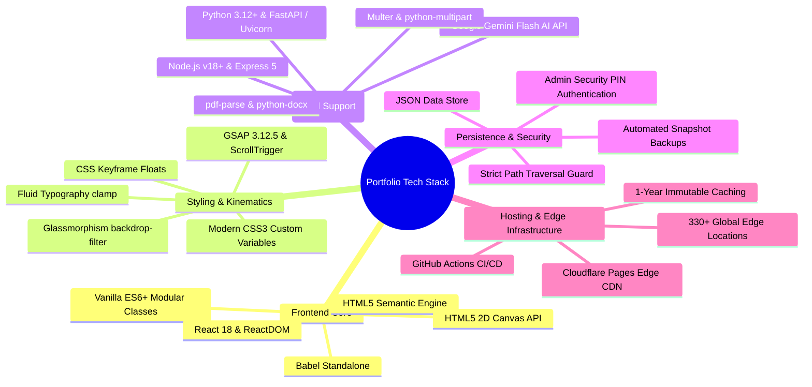
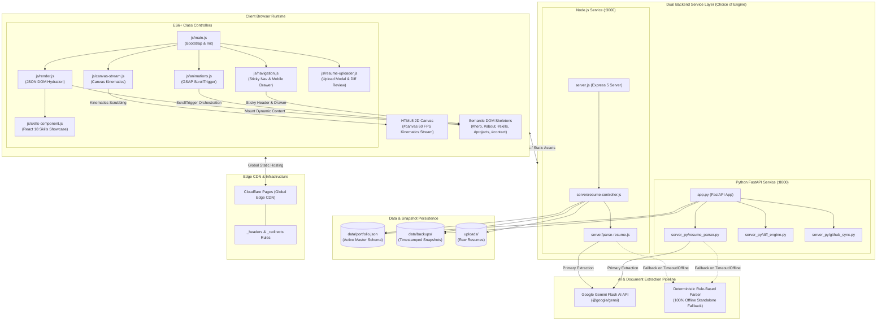
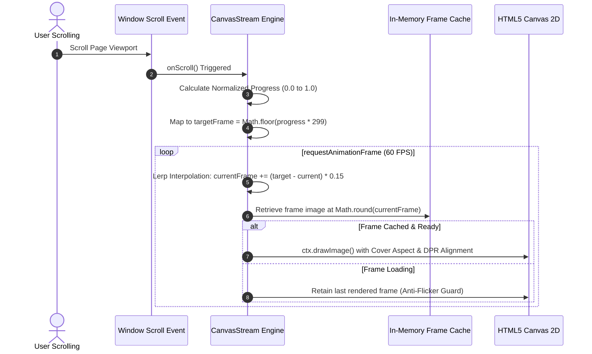
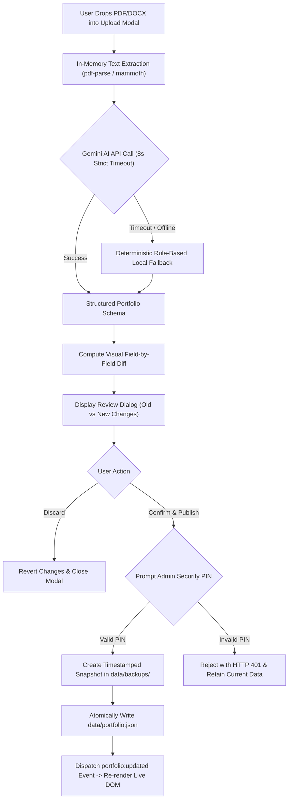
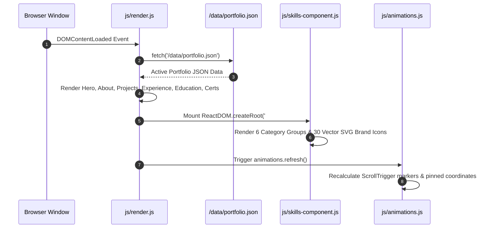
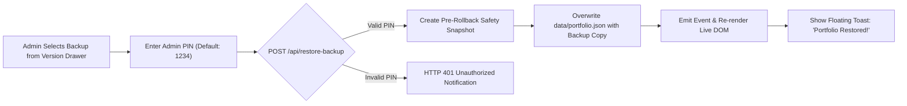
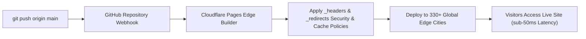

# 🌌 Md MatlooB Alam — Full Stack & UI Kinematics Portfolio

<div align="center">

<!-- Animated Name & Title Header -->
<a href="https://alam292-portfolio.pages.dev">
  
</a>

<p align="center">
  
</p>

[](https://alam292-portfolio.pages.dev)
[](package.json)
[](https://alam292-portfolio.pages.dev)
[](https://github.com/alam292/Protfolio)
[](test-runner.js)
[](js/canvas-stream.js)
[](LICENSE)

<p align="center">
  <strong>Md MatlooB Alam</strong> &bull; <em>Software Developer &amp; UI Systems Engineer</em><br>
  <span>📍 Bokaro Steel City, Jharkhand, India &bull; IST (UTC+5:30) &bull; <a href="mailto:mdmatloobgaya@gmail.com">mdmatloobgaya@gmail.com</a></span>
</p>

> A high-performance, cinematic developer portfolio engineered with **modular ES6+ architecture**, a **300-frame hardware-accelerated HTML5 Canvas stream**, **GSAP ScrollTrigger kinematics**, an enterprise **Glassmorphism Design System**, and an **AI-powered dynamic resume ingestion engine** with automated snapshots, diff review, and 1-click rollback.

</div>

---

## 📑 Table of Contents

- [✨ Project Highlights](#-project-highlights)
- [🛠️ Tech Stack & Technologies](#️-tech-stack--technologies)
- [🏗️ Architecture Design](#️-architecture-design)
  - [System Architecture Diagram](#system-architecture-diagram)
  - [Architectural Layers](#architectural-layers)
- [🔄 Core Workflows](#-core-workflows)
  - [1. 300-Frame Canvas Kinematics Stream](#1-300-frame-canvas-kinematics-stream)
  - [2. AI Resume Ingestion, Diff & 2-Step Publish Workflow](#2-ai-resume-ingestion-diff--2-step-publish-workflow)
  - [3. Dynamic DOM Hydration & Reactive Rendering](#3-dynamic-dom-hydration--reactive-rendering)
  - [4. Automated Snapshot Backup & 1-Click Rollback](#4-automated-snapshot-backup--1-click-rollback)
  - [5. Cloudflare Pages Global Edge Deployment & CI/CD](#5-cloudflare-pages-global-edge-deployment--cicd)
- [📌 Version History & Releases](#-version-history--releases)
- [📂 Project Structure](#-project-structure)
- [🚀 Quick Start & Installation](#-quick-start--installation)
  - [Option A: Node.js Express Server](#option-a-nodejs-express-server)
  - [Option B: Python FastAPI Backend](#option-b-python-fastapi-backend)
  - [Option C: One-Click Windows Launch](#option-c-one-click-windows-launch)
- [🧪 Automated Testing & Verification](#-automated-testing--verification)
- [🎨 Design Tokens & UI Architecture](#-design-tokens--ui-architecture)
- [👨‍💻 Author & Contact](#-author--contact)

---

## ✨ Project Highlights

- **300-Frame Kinematics Canvas Stream**: Preloads a sequential 300-frame image stream rendered on an HTML5 2D Canvas with sub-pixel Lerp interpolation and dynamic Device Pixel Ratio (DPR) adaptation at 60 FPS.
- **AI Dynamic Ingestion Engine**: Upload PDF/DOCX resumes directly from the browser; Google Gemini Flash AI extracts structured milestones and automatically updates the portfolio with side-by-side diff inspection.
- **Automated Snapshots & 1-Click Rollback**: Every portfolio modification creates a timestamped JSON snapshot with PIN-secured admin authorization and instant rollback capability.
- **Modern Interactive Tech Showcase**: Categorized technology matrix rendered dynamically via React 18 and SVG brand vectors with floating keyframe kinematics and radiant glow filters.
- **Zero-Layout Shift & Instant TTI**: Strict CSS `clamp()` fluid typography, pre-sized media containers, and edge caching deliver zero CLS and instant responsiveness.
- **Dual Backend Support**: Native execution on either a Node.js Express API streaming server or a Python FastAPI asynchronous service.

---

## 🛠️ Tech Stack & Technologies



### Detailed Technology Matrix

| Layer / Category | Technology | Version | Purpose & Implementation |
| :--- | :--- | :---: | :--- |
| **Frontend Language** | **JavaScript (ES6+)** | ES2022+ | Modular class controllers (`CanvasStream`, `NavigationController`, `AnimationsController`, `FormController`, `ResumeUploader`). |
| **Markup & Semantics** | **HTML5** | Living Spec | Semantic landmarks (`header`, `main`, `section`, `article`, `footer`), JSON-LD Person schema. |
| **Styling & Design System** | **CSS3 Modern** | Modern Spec | Modular CSS architecture, CSS variables, glassmorphic blur filters, CSS Grid & Flexbox, fluid `clamp()` sizing. |
| **Motion & Kinematics** | **GSAP & ScrollTrigger** | `3.12.5` | Viewport scrub timelines, pinned coordinates, stagger reveal animations, hardware-accelerated transforms. |
| **Canvas Streaming** | **HTML5 2D Canvas API** | W3C Standard | Double-buffered 2D canvas, `desynchronized: true`, Lerp interpolation, aspect-ratio cover calculations. |
| **Dynamic Components** | **React & ReactDOM** | `18.2.0` | Powers interactive skills category matrix with SVG icons and live filtering. |
| **Backend Runtime (Node)** | **Node.js + Express** | `18.0+ / 5.3.0` | Native HTTP streaming, Range requests, cache headers, multipart file ingestion, and admin API endpoints. |
| **Backend Runtime (Python)** | **Python + FastAPI** | `3.12+ / 0.110+` | High-performance asynchronous REST backend, Pydantic data validation, automated GitHub sync engine. |
| **AI Intelligence** | **Google Gemini Flash** | `@google/genai` | Autonomous structured resume parsing and schema transformation with local deterministic fallback. |
| **Document Parsers** | **PDF-Parse & Mammoth** | `2.4.5 / 1.13.0` | In-memory text extraction from uploaded PDF and DOCX documents. |
| **Edge CDN Hosting** | **Cloudflare Pages** | Production | Global edge delivery across 330+ cities with automated GitHub CI/CD, SSL/TLS, and security headers. |
| **Automated Testing** | **Custom Test Runner** | Built-in | 12 automated verification suites evaluating DOM, APIs, backups, security, and rendering (182 assertions). |

---

## 🏗️ Architecture Design

### System Architecture Diagram



### Architectural Layers

1. **Presentation & Viewport Layer**:
   - Fixed hardware-accelerated HTML5 Canvas rendering 300 sequential frames.
   - Glassmorphism UI containers (`backdrop-filter: blur(16px)`).
   - Left-handed ergonomic mobile navigation drawer with touch gestures and ARIA focus trapping.
2. **Modular Controller Layer**:
   - `CanvasStream`: Manages frame caching, scroll progress normalization, and Lerp smoothing.
   - `AnimationsController`: Configures GSAP ScrollTrigger timelines for reveal sequences.
   - `NavigationController`: Controls sticky header transformations, scrollspy, and drawer state.
   - `ResumeUploader`: Manages drag-and-drop file staging, progress animations, and review diffs.
3. **Backend Service & Ingestion Layer**:
   - Dual-engine architecture: Node.js Express (`server.js`) or Python FastAPI (`app.py`).
   - Strict HTTP security: Path traversal guards, MIME mapping, CORS validation, and admin PIN checks (`x-admin-pin`).
4. **AI Transformation & Parsing Engine**:
   - Google Gemini Flash model extracts structured portfolio schemas from raw text.
   - 8-second strict timeout with automated failover to deterministic local regex parser.
5. **Data & Version Persistence Layer**:
   - Single source of truth in `data/portfolio.json`.
   - Immutable historical snapshots in `data/backups/portfolio-*.json` enabling 1-click rollbacks.

---

## 🔄 Core Workflows

### 1. 300-Frame Canvas Kinematics Stream

The cinematic background sequence is calculated in real time using viewport scroll kinematics:



---

### 2. AI Resume Ingestion, Diff & 2-Step Publish Workflow

Upload new CVs with instant visual diff review before changing production data:



---

### 3. Dynamic DOM Hydration & Reactive Rendering

The portfolio loads dynamically without heavy bundlers or build steps:



---

### 4. Automated Snapshot Backup & 1-Click Rollback

Ensures 100% data safety and rollback protection:



---

### 5. Cloudflare Pages Global Edge Deployment & CI/CD



---

## 📌 Version History & Releases

| Version | Release Date | Status | Short Description |
| :---: | :---: | :---: | :--- |
| **`v1.3.0`** | **Nov 2026** | **Current Stable** | **Phase 3 & 4 Two-Step AI Review, PIN Protection & Mobile Overhaul**<br>&bull; Two-step upload with visual diff preview modal before publishing.<br>&bull; Admin security PIN verification for publish and restore operations.<br>&bull; Automated snapshots with 1-click rollback drawer.<br>&bull; 8-second AI timeout with instantaneous deterministic fallback.<br>&bull; Mobile navigation drawer touch scrollability & responsive UI fixes.<br>&bull; 12 automated test suites passing with 182 verification checks. |
| **`v1.2.0`** | **Nov 2026** | **Deployed** | **Cloudflare Pages Production Deployment & Edge Optimization**<br>&bull; Zero-cost global hosting on Cloudflare Pages across 330+ edge locations.<br>&bull; Automated GitHub CI/CD continuous deployment pipeline.<br>&bull; 1-year immutable edge caching for 300 sequential animation frames.<br>&bull; Production security headers (`_headers`) and SPA routing (`_redirects`). |
| **`v1.1.0`** | **Nov 2026** | **Released** | **Modern Technology Skills Matrix & React Integration**<br>&bull; Categorized technical taxonomy with 6 structured domains.<br>&bull; 30 authentic brand SVG vector icons with radiant hover glow.<br>&bull; Dynamic React 18 component mounting into `#skillsMount`.<br>&bull; Staggered GSAP ScrollTrigger entrance animations and float kinematics. |
| **`v1.0.0`** | **Nov 2026** | **Initial Release** | **Core Cinematic Engine & Design System**<br>&bull; 300-frame hardware-accelerated scroll-scrubbed HTML5 Canvas engine.<br>&bull; 8 complete modular sections with Glassmorphism design system.<br>&bull; Zero-dependency Node.js streaming HTTP server.<br>&bull; Accessible mobile drawer navigation, live contact validation, and toast alerts. |

---

## 📂 Project Structure

```text
d:\Project\Protfolio\
├── assets/                               # Static media, vector SVGs & authoritative resume
│   ├── bottle.jpg                        # Lifestyle media
│   ├── headphones.jpg                    # Audio showcase media
│   ├── jacket.jpg                        # Apparel asset
│   ├── profile-avatar.svg                # Fallback vector avatar
│   ├── profile-matloob-clean.png         # Author portrait asset
│   ├── profile-matloob-transparent.png   # Transparent hero author portrait
│   ├── project-cloudscale.svg            # CloudScale AI SaaS graphic
│   ├── project-devflow.svg               # DevFlow CI/CD orchestrator graphic
│   ├── project-hospital.svg              # Hospital Management graphic
│   ├── project-hotel.svg                 # Hotel Management graphic
│   ├── project-nexusui.svg               # NexusUI design system graphic
│   ├── project-pulsemetrics.svg          # PulseMetrics telemetry graphic
│   └── Md_MatlooB_Alam_Resume.pdf        # Authoritative verified CV
├── css/                                  # Modular Design System Architecture
│   ├── main.css                          # Central stylesheet orchestrator
│   ├── reset.css                         # CSS reset, box-sizing & defaults
│   ├── variables.css                     # Global design tokens (colors, typography, radii)
│   ├── layout.css                        # Canvas container, layout grid & vignette overlays
│   ├── animations.css                    # Keyframe animations, pulse glows & float physics
│   ├── responsive.css                    # Breakpoint-specific media queries (320px to 2560px)
│   └── components/                       # Encapsulated component stylesheets
│       ├── about.css                     # About section, metrics & narrative pillars
│       ├── brands.css                    # Partner & technology marquee ribbon
│       ├── buttons.css                   # Glassmorphic button states & tactile interactions
│       ├── cards.css                     # Translucent card containers & hover elevations
│       ├── certificates.css              # Verified credentials & license showcase
│       ├── contact.css                   # Interactive contact form, inputs & status badge
│       ├── drawer.css                    # Accessible left-side mobile navigation drawer
│       ├── education.css                 # Academic timeline & coursework cards
│       ├── experience.css                # Professional milestones & career progression
│       ├── footer.css                    # Footer bar & floating back-to-top button
│       ├── hero.css                      # Hero headline, author badge & quick metrics
│       ├── navbar.css                    # Sticky glass header & navigation links
│       ├── projects.css                  # Featured projects browser mockup & tags
│       ├── skills.css                    # Technology taxonomy grid & glowing icons
│       └── upload-modal.css              # AI upload modal, diff review & version drawer
├── data/                                 # Central Data Store & Version Backups
│   ├── portfolio.json                    # Single source of truth (Active JSON schema)
│   └── backups/                          # Timestamped historical snapshot backups
├── doc/                                  # Architectural specifications & design plans
│   ├── ABOUT_ME_PLAN.md                  # Narrative strategy & core pillars
│   ├── CERTIFICATIONS_ACHIEVEMENTS_PLAN.md # Credentials & verified achievements
│   ├── CONTACT_SECTION_PLAN.md           # Form layout & contact specs
│   ├── EDUCATION_PLAN.md                 # Academic progression & degrees
│   ├── EXPERIENCE_PLAN.md                # Employment milestones & STAR metrics
│   ├── FEATURED_PROJECTS_PLAN.md         # Project benchmarks & architectural specs
│   └── TECHNICAL_SKILLS_PLAN.md          # 6-tier technical skill taxonomy
├── ezgif-8638738b594a7204-jpg/           # 300-frame sequential canvas animation stream
│   ├── ezgif-frame-001.jpg               # Frame 001 (Hero state)
│   ├── ...                               # Frames 002 through 299
│   └── ezgif-frame-300.jpg               # Frame 300 (Footer culmination)
├── js/                                   # Vanilla ES6+ & Dynamic React Controllers
│   ├── main.js                           # Entry point & controller orchestrator
│   ├── canvas-stream.js                  # 300-frame canvas kinematics & DPR loader
│   ├── animations.js                     # GSAP ScrollTrigger timeline controller
│   ├── navigation.js                     # Sticky navbar, drawer toggle & scrollspy
│   ├── render.js                         # Dynamic section renderer from portfolio.json
│   ├── skills-component.js               # React 18 / SVG technology showcase module
│   ├── resume-uploader.js                # Upload modal, diff preview & backup restore
│   ├── form.js                           # Form validation engine & floating toast alerts
│   └── theme.js                          # Theme switcher controller
├── server/                               # Node.js Ingestion & Controller Modules
│   ├── parse-resume.js                   # Gemini AI transformer & deterministic rule parser
│   └── resume-controller.js              # Multer storage, diff engine & backup controllers
├── server_py/                            # Python FastAPI Modules
│   ├── diff_engine.py                    # Python side-by-side portfolio diff engine
│   ├── github_sync.py                    # Automated GitHub commit & push sync service
│   └── resume_parser.py                  # Python Gemini AI parser & schema extractor
├── uploads/                              # Temporary uploaded resume storage (.gitkeep)
├── _headers                              # Cloudflare Pages production edge security & cache headers
├── _redirects                            # Cloudflare Pages single-page application fallback rules
├── app.py                                # High-performance Python FastAPI backend application
├── server.js                             # Zero-dependency Node.js streaming & API server
├── test-runner.js                        # 12-suite automated verification runner (182 checks)
├── package.json                          # Node.js project metadata & scripts
├── requirements.txt                      # Python dependencies (FastAPI, uvicorn, google-genai)
├── start.bat                             # One-click Windows launch script (Node.js)
├── start_python.bat                      # One-click Windows launch script (FastAPI)
├── index.html                            # Master HTML5 single-page application
└── README.md                             # Comprehensive project documentation
```

---

## 🚀 Quick Start & Installation

### Prerequisites

- **Node.js**: Version `18.0.0` or higher (for Node.js runtime).
- **Python**: Version `3.10+` (optional, for FastAPI runtime).
- Any modern web browser (Chrome, Firefox, Safari, Edge) with WebGL and HTML5 Canvas support.

---

### Option A: Node.js Express Server

1. **Clone the repository**:
   ```bash
   git clone https://github.com/alam292/Protfolio.git
   cd Protfolio
   ```

2. **Install Node dependencies**:
   ```bash
   npm install
   ```

3. **Configure Environment Variables** (Optional for AI parsing):
   Create a `.env` file in the root directory:
   ```env
   PORT=3000
   ADMIN_PIN=1234
   GEMINI_API_KEY=your_gemini_api_key_here
   ```

4. **Start the local server**:
   ```bash
   npm start
   ```

5. **Open in Browser**:
   Navigate to [http://localhost:3000](http://localhost:3000).

---

### Option B: Python FastAPI Backend

1. **Create and activate a virtual environment**:
   ```bash
   python -m venv venv
   # On Windows:
   .\venv\Scripts\activate
   # On macOS/Linux:
   source venv/bin/activate
   ```

2. **Install Python dependencies**:
   ```bash
   pip install -r requirements.txt
   ```

3. **Launch FastAPI with Uvicorn**:
   ```bash
   uvicorn app:app --host 127.0.0.1 --port 8000 --reload
   ```

4. **Open in Browser**:
   Navigate to [http://localhost:8000](http://localhost:8000).

---

### Option C: One-Click Windows Launch

- **For Node.js Server**: Double-click `start.bat`.
- **For Python FastAPI**: Double-click `start_python.bat`.

---

## 🧪 Automated Testing & Verification

The project includes an enterprise-grade automated test runner (`test-runner.js`) ensuring architectural integrity, schema compliance, asset health, and security:

```bash
# Execute all 12 test suites
npm test
```

### Verification Suites Overview

| Suite | Focus Area | Description | Checks | Status |
| :---: | :--- | :--- | :---: | :---: |
| **Suite 1** | **Data Store & Resume** | Validates `portfolio.json` author, PDF integrity (>1KB), stats, skills, degrees, and emails. | `11/11` | `PASS` |
| **Suite 2** | **Asset Integrity** | Asserts all critical vector SVGs and PDF documents exist on disk with positive byte size. | `5/5` | `PASS` |
| **Suite 3** | **DOM Skeleton & Nav** | Confirms 8 semantic sections, dynamic `#*Mount` containers, anchors, and JSON-LD schema. | `27/27` | `PASS` |
| **Suite 4** | **AI Resume Modal** | Tests upload dropzone, progress bars, review buttons, diff toggles, and version drawer. | `16/16` | `PASS` |
| **Suite 5** | **Text Extraction & Parser** | Tests in-memory PDF extraction and deterministic rule parser fallback without network. | `9/9` | `PASS` |
| **Suite 6** | **HTTP Server Endpoints** | Verifies HTTP 200 responses, correct MIME headers, and health endpoint status. | `22/22` | `PASS` |
| **Suite 7** | **Resume Upload API** | Executes real multipart PDF upload against `/api/upload-resume` and verifies persistence. | `4/4` | `PASS` |
| **Suite 8** | **Form Validation Engine** | Evaluates email regex against complex subdomains, valid formats, and boundary attacks. | `5/5` | `PASS` |
| **Suite 9** | **Modern Skills Matrix** | Verifies 6 categories, 30 SVG brand icons, dynamic React exports, and glow keyframes. | `61/61` | `PASS` |
| **Suite 10** | **Left Mobile Drawer** | Tests left-aligned toggle, slide-in keyframes, chevron indicators, and touch accessibility. | `12/12` | `PASS` |
| **Suite 11** | **Two-Step Diff Review** | Tests diff engine accuracy on names, skills, highlights, and safe staging without disk overwrite. | `7/7` | `PASS` |
| **Suite 12** | **Rollback & Admin PIN** | Tests PIN rejection (HTTP 401), traversal blocking (HTTP 400), snapshot creation & restoration. | `3/3` | `PASS` |

```text
======================================================
TOTAL CHECKS: 182 | PASSED: 182 | FAILED: 0
>>> ALL AUTOMATED VERIFICATION SUITES PASSED! 100% PRODUCTION READY. <<<
======================================================
```

---

## 🎨 Design Tokens & UI Architecture

| Token Variable | Default Value | Role / Usage |
| :--- | :--- | :--- |
| `--bg-dark` | `#030608` | Primary cinematic deep viewport background |
| `--bg-deep` | `#070b10` | Secondary surface backdrop |
| `--bg-surface` | `#0c1117` | Card base layer and elevated surfaces |
| `--accent-orange` | `#ff5722` | Brand focal accent color |
| `--accent-orange-hover` | `#ff6e3d` | Button hover and link active highlights |
| `--accent-orange-glow` | `rgba(255, 87, 34, 0.35)` | Atmospheric brand glow and box-shadows |
| `--glass-bg` | `rgba(14, 18, 24, 0.55)` | Translucent frosted glass background |
| `--glass-border` | `rgba(255, 255, 255, 0.08)` | Luminescent frosted glass edge border |
| `--font-primary` | `'Plus Jakarta Sans', sans-serif` | Clean, ergonomic body and interface typography |
| `--font-display` | `'Syne', sans-serif` | High-impact headlines and numerical callouts |

For the complete design system manual, refer to [DESIGN_SYSTEM.md](DESIGN_SYSTEM.md).

---

## 👨‍💻 Author & Contact

**Md MatlooB Alam**  
*Software Developer &amp; UI Systems Engineer*

- 🌐 **Live Portfolio**: [https://alam292-portfolio.pages.dev](https://alam292-portfolio.pages.dev)
- 🐙 **GitHub**: [github.com/mdmatloobalam](https://github.com/mdmatloobalam) &bull; [github.com/alam292](https://github.com/alam292)
- 💼 **LinkedIn**: [linkedin.com/in/mdmatloobalam](https://linkedin.com/in/mdmatloobalam)
- 📧 **Email**: [mdmatloobgaya@gmail.com](mailto:mdmatloobgaya@gmail.com)
- 📍 **Location**: Bokaro Steel City, Jharkhand, India (IST &bull; UTC+5:30)

---

<div align="center">
  <sub>Crafted with passion, clean code, and 60 FPS scroll kinematics &bull; &copy; 2026 Md MatlooB Alam. All rights reserved.</sub>
</div>
