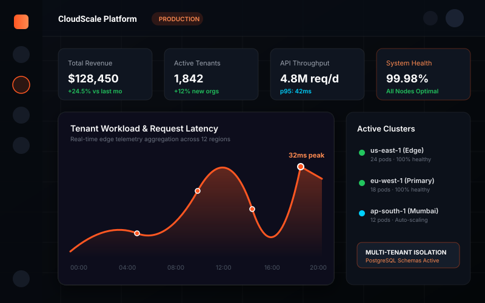
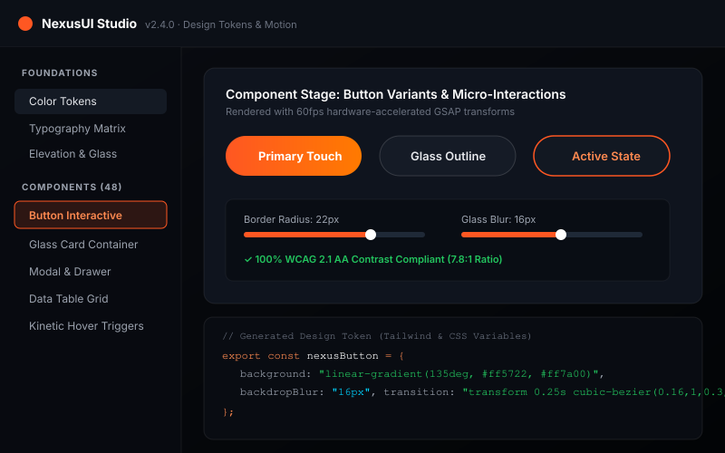
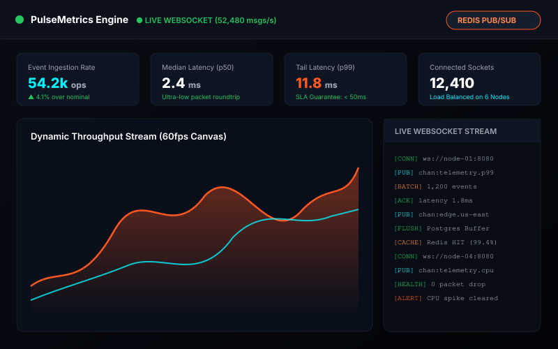
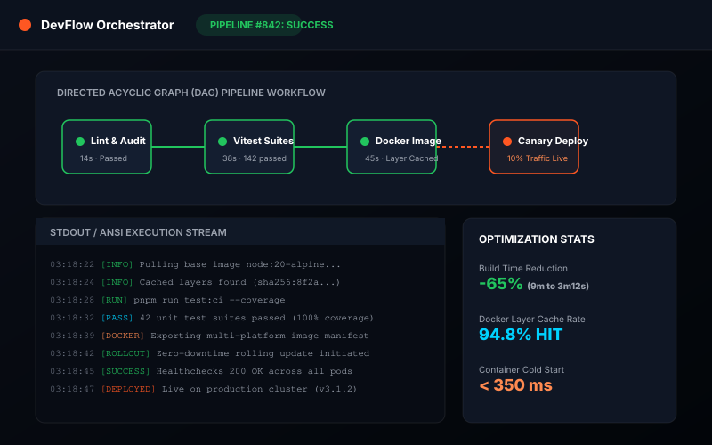
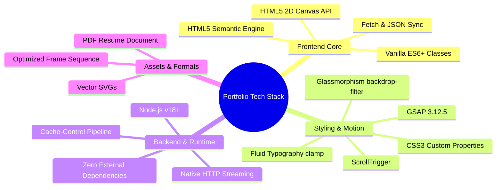
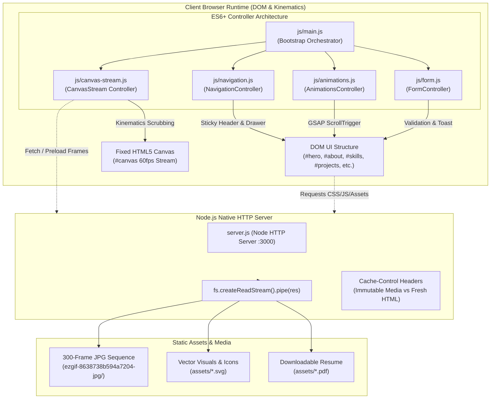
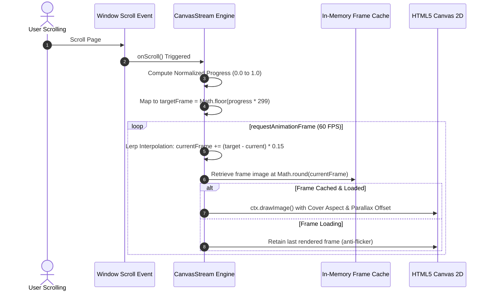
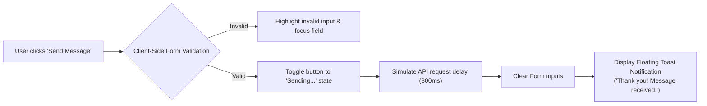

# 🌌 Md MatlooB Alam — Full Stack & UI Kinematics Portfolio

[](package.json)
[](package.json)
[](server.js)
[](js/canvas-stream.js)
[](DESIGN_SYSTEM.md)
[](LICENSE)

> A production-grade, cinematic portfolio engineered with **modular vanilla ES6+**, a **300-frame hardware-accelerated HTML5 Canvas stream**, **GSAP ScrollTrigger kinematics**, and an enterprise **Glassmorphism Design System**.

---

<p align="center">
  
</p>
<p align="center">
  <strong>Md MatlooB Alam</strong><br>
  <em>Full Stack Developer &amp; UI Systems Engineer</em><br>
  <span>Bokaro Steel City, Jharkhand, India &bull; IST (UTC+5:30)</span>
</p>

---

## 📑 Table of Contents

- [✨ Project Overview](#-project-overview)
- [🖼️ Visual Showcase & Media](#️-visual-showcase--media)
- [🛠️ Tech Stack](#️-tech-stack)
- [🏗️ System Architecture](#️-system-architecture)
- [🔄 Core Workflows & Kinematics](#-core-workflows--kinematics)
  - [1. 300-Frame Canvas Stream Workflow](#1-300-frame-canvas-stream-workflow)
  - [2. Navigation & ScrollSpy Workflow](#2-navigation--scrollspy-workflow)
  - [3. Interactive Form Submission & Toast Workflow](#3-interactive-form-submission--toast-workflow)
  - [4. Node.js Asset Streaming & Caching Workflow](#4-nodejs-asset-streaming--caching-workflow)
  - [5. AI Resume Auto-Sync & Dynamic Update Workflow](#5-ai-resume-auto-sync--dynamic-update-workflow)
- [📂 Directory & Module Structure](#-directory--module-structure)
- [🚀 Quick Start & Installation](#-quick-start--installation)
- [📌 Versioning & Release History](#-versioning--release-history)
- [🎨 Design Tokens & UI Architecture](#-design-tokens--ui-architecture)
- [👨‍💻 Author & Contact](#-author--contact)

---

## ✨ Project Overview

This portfolio serves as both an interactive personal brand showcase and a high-performance engineering playground. Built entirely without heavy frontend framework dependencies, it achieves instant Time-To-Interactive (TTI), zero Cumulative Layout Shift (CLS), and fluid 60 FPS scrolling animations.

### 🌟 Key Highlights

- **Hardware-Accelerated Canvas Stream**: Preloads and renders 300 sequential high-resolution frames mapped seamlessly to viewport scroll kinematics.
- **Micro-Interaction & Motion Orchestration**: Powered by GSAP 3.12 and ScrollTrigger with GPU-optimized transforms (`translate3d`, `opacity`).
- **Responsive Glassmorphism Design System**: Tailored across 5 device tiers (Ultrawide, Laptop, Tablet, Phablet, Mobile Portrait) using modern CSS `clamp()` fluid scales.
- **Zero-Dependency Native Streaming Server**: Built with Node.js standard libraries (`http`, `fs`, `path`) providing HTTP Range requests, immutable image caching headers, and security bounds checks.
- **Accessible & SEO Optimized**: WCAG 2.1 AA compliant colors, keyboard navigation traps for mobile drawer, ARIA dialogs, and semantic markup.

---

## 🖼️ Visual Showcase & Media

### Flagship Projects

| Project | Preview | Core Technologies | Architecture Focus |
| :--- | :---: | :--- | :--- |
| **CloudScale AI**<br>Enterprise Multi-Tenant SaaS |  | Next.js 14, TypeScript, Node.js, PostgreSQL | Schema-per-tenant isolation, real-time cloud resource metering, Stripe webhooks. |
| **NexusUI Studio**<br>Kinetic Design System |  | React 18, TypeScript, GSAP Motion, Tailwind | 4.2kB gzipped core, automated Figma-to-CSS tokens, 100% WCAG AA compliance. |
| **PulseMetrics**<br>Real-Time Observability Engine |  | Node.js, Express, WebSockets, Redis, Canvas | Ingests 50k+ events/sec, low-latency 60 FPS Canvas telemetry charts. |
| **DevFlow**<br>CI/CD Automation Orchestrator |  | Go, Docker, Kubernetes, GraphQL, React | Distributed pipeline engine, 65% build duration reduction, remote cache sharing. |

### Cinematic 300-Frame Image Stream Sample

The background stream is driven by a 300-frame image sequence located in `ezgif-8638738b594a7204-jpg/`:
- **Initial Frame**: `ezgif-frame-001.jpg` (Hero intro state)
- **Midpoint Transition**: `ezgif-frame-150.jpg` (Interactive transition across project & experience milestones)
- **Culmination Frame**: `ezgif-frame-300.jpg` (Outro & contact focal alignment)

---

## 🛠️ Tech Stack



### Layer Details

| Category | Technology | Version | Purpose & Usage |
| :--- | :--- | :--- | :--- |
| **Language** | **JavaScript (ES6+)** | ES2022+ | Class-based controllers (`CanvasStream`, `NavigationController`, `AnimationsController`, `FormController`). |
| **Markup** | **HTML5** | Living Standard | Semantic document structure, accessibility landmarks (`header`, `main`, `section`, `article`, `footer`). |
| **Styling** | **CSS3** | Modern Spec | Modular CSS architecture, CSS variables, glassmorphic blur filters, CSS Grid & Flexbox layouts. |
| **Kinematics Engine** | **HTML5 2D Canvas** | W3C Standard | Double-buffered 2D canvas, `desynchronized: true`, aspect-ratio cover calculations, dynamic DPR adaptation. |
| **Motion Library** | **GSAP & ScrollTrigger** | `3.12.5` | Smooth scrubbing timelines, pinned layout coordinates, stagger reveal effects. |
| **Local Web Server** | **Node.js HTTP Server** | `>= 18.0.0` | Native HTTP streaming, MIME resolution, cache header enforcement (`max-age=86400`). |
| **Fonts** | **Google Fonts** | Hosted CDN | `Plus Jakarta Sans` (body and UI text) and `Syne` (high-contrast display titles). |

---

## 🏗️ System Architecture

### Architectural Block Diagram



---

## 🔄 Core Workflows & Kinematics

### 1. 300-Frame Canvas Stream Workflow

The cinematic background scroll animation is calculated in real time using viewport scroll telemetry:



### 2. Navigation & ScrollSpy Workflow

- **Sticky Glass Navbar**: Listens to scroll positions; toggles `.navbar-scrolled` when scroll `Y > 20px`, adding a frosted `backdrop-filter: blur(16px)`.
- **IntersectionObserver ScrollSpy**: Observes all eight main page sections (`#hero`, `#about`, `#skills`, `#projects`, `#experience`, `#education`, `#certificates`, `#contact`), dynamically reflecting the active section in desktop navbar links and mobile drawer items.
- **Mobile Drawer & Accessibility**: Toggles ARIA states (`aria-expanded`, `aria-hidden`) and traps focus when the drawer is open to adhere to WCAG accessibility principles.

### 3. Interactive Form Submission & Toast Workflow



### 4. Node.js Asset Streaming & Caching Workflow

The server implementation in `server.js` provides:
1. **Security URL Resolution**: Decodes URI components and verifies file paths stay confined within `PUBLIC_DIR` to prevent path traversal attacks.
2. **Dynamic MIME Mapping**: Automatically associates 12+ file extensions with correct headers (`.html`, `.css`, `.js`, `.json`, `.svg`, `.jpg`, `.pdf`, etc.).
3. **Optimized Cache Control**:
   - High-volume binary frames & images (`.jpg`, `.png`, `.webp`): `Cache-Control: public, max-age=86400, immutable`
   - Dynamic documents (`.html`, `.js`, `.css`): `Cache-Control: no-cache, no-store, must-revalidate`
4. **Stream Piping**: Uses `fs.createReadStream()` with automatic error and close handling to prevent memory leaks during rapid scrubbing.

### 5. AI Resume Auto-Sync & Dynamic Update Workflow

The portfolio features direct resume ingestion and Google Gemini AI transformation:
1. **User Upload Trigger**: User drops a PDF or DOCX resume into the drag-and-drop modal.
2. **Automated Backup**: `server/resume-controller.js` creates a timestamped snapshot in `data/backups/`.
3. **In-Memory Text Extraction**: `server/parse-resume.js` parses the file buffer using `pdf-parse` or `mammoth`.
4. **Intelligent Schema Transformation**: Google Gemini Flash API (`@google/genai`) populates the 8-section portfolio schema (with automatic fallback to local rule-based parser if offline).
5. **Atomic Save & Live Dispatch**: Updates `data/portfolio.json`, emits `portfolio:updated` event, and `js/render.js` re-renders the live DOM with refreshed scroll triggers.

For detailed architecture and configuration, see [RESUME_AUTO_UPDATE_GUIDE.md](RESUME_AUTO_UPDATE_GUIDE.md).

---

## 📂 Directory & Module Structure

```text
d:\Project\Protfolio\
├── assets/                               # Static brand media & vector graphics
│   ├── bottle.jpg                        # Lifestyle project media
│   ├── headphones.jpg                    # Audio hardware media
│   ├── jacket.jpg                        # Apparel asset
│   ├── profile-avatar.svg                # Author avatar badge
│   ├── project-cloudscale.svg            # CloudScale AI SaaS mockups
│   ├── project-devflow.svg               # DevFlow CI/CD orchestrator mockup
│   ├── project-nexusui.svg               # NexusUI design system mockup
│   ├── project-pulsemetrics.svg          # PulseMetrics telemetry mockup
│   ├── Md_MatlooB_Alam_Resume.pdf        # Authoritative verified CV
│   └── resume.pdf                        # Quick download alias
├── css/                                  # Modular Design System Architecture
│   ├── main.css                          # Central stylesheet orchestrator
│   ├── reset.css                         # CSS reset, box-sizing & base rules
│   ├── variables.css                     # Global design tokens (colors, fonts, radii)
│   ├── layout.css                        # Global canvas container, vignette & structure
│   ├── animations.css                    # Keyframe animations, pulse radials & easing
│   ├── responsive.css                    # Breakpoint-specific media queries
│   └── components/                       # Encapsulated component styling
│       ├── about.css                     # About section, metrics & narrative pillars
│       ├── brands.css                    # Partner / client marquee ribbon
│       ├── buttons.css                   # Tactile button styles & icon circular badges
│       ├── cards.css                     # Glassmorphic card containers & hover states
│       ├── certificates.css              # Verified credentials & license showcase
│       ├── contact.css                   # Contact cards, form inputs & status badge
│       ├── drawer.css                    # Mobile slide-out navigation drawer
│       ├── education.css                 # Academic timeline & coursework cards
│       ├── experience.css                # Professional experience & career progression
│       ├── footer.css                    # Footer bar & floating back-to-top button
│       ├── hero.css                      # Hero headline, author badge & quick pillars
│       ├── navbar.css                    # Desktop sticky header & logo styling
│       ├── projects.css                  # Featured projects browser chrome & tags
│       └── skills.css                    # Technical taxonomy grid & capability pills
├── doc/                                  # Architectural plans & documentation
│   ├── ABOUT_ME_PLAN.md                  # Narrative strategy & 4 core pillars
│   ├── CERTIFICATIONS_ACHIEVEMENTS_PLAN.md # Credentials & verified achievements
│   ├── CONTACT_SECTION_PLAN.md           # Form layout & location overlap specs
│   ├── EDUCATION_PLAN.md                 # Academic progression & honors
│   ├── EXPERIENCE_PLAN.md                # Employment milestones & STAR metrics
│   ├── FEATURED_PROJECTS_PLAN.md         # Detailed project specs & benchmarks
│   ├── HOME_SECTION_DYNAMIC_PLAN.md      # Hero kinematics & data bindings
│   ├── TECHNICAL_SKILLS_PLAN.md          # 5-tier technical skill taxonomy
│   └── plan.md                           # Master documentation overview
├── ezgif-8638738b594a7204-jpg/           # 300-frame sequential animation stream
│   ├── ezgif-frame-001.jpg               # Frame 001
│   ├── ...                               # Frames 002 through 299
│   └── ezgif-frame-300.jpg               # Frame 300
├── js/                                   # Vanilla ES6+ Modular Controllers
│   ├── animations.js                     # GSAP ScrollTrigger timeline orchestrator
│   ├── canvas-stream.js                  # 300-frame canvas kinematics & DPR loader
│   ├── form.js                           # Form validation & floating toast alerts
│   ├── main.js                           # Entry point & module bootstrap
│   └── navigation.js                     # Sticky navbar, drawer toggle & scrollspy
├── DESIGN_SYSTEM.md                      # UI tokens, color palettes & breakpoints
├── RESUME_AUTO_UPDATE_PLAN.md            # Automated dynamic resume data plan
├── index.html                            # Master HTML5 single-page application
├── package.json                          # Project metadata & start script
├── server.js                             # Zero-dependency Node.js streaming server
├── start.bat                             # One-click Windows launch script
└── README.md                             # Comprehensive technical documentation
```

---

## 🚀 Quick Start & Installation

### Prerequisites

- **Node.js**: Version `18.0.0` or higher recommended.
- Any modern evergreen web browser (Chrome, Edge, Firefox, Safari) with WebGL and HTML5 Canvas support.

### Running Locally

1. **Clone or Navigate to the Workspace**:
   ```bash
   cd d:/Project/Protfolio
   ```

2. **Launch the Streaming Server**:
   ```bash
   # Option A: Using npm script
   npm start

   # Option B: Using Node directly
   node server.js

   # Option C: On Windows, double-click start.bat
   ```

3. **Open the Portfolio**:
   Navigate to [http://localhost:3000](http://localhost:3000) in your browser.

---

## 📌 Versioning & Release History

| Version | Release Date | Summary of Changes |
| :---: | :---: | :--- |
| **`v1.0.0`** | **November 2026** | **Initial Production Release**<br>&bull; Fully integrated 300-frame scroll-scrubbed canvas engine.<br>&bull; 8 complete modular sections (Hero, About, Skills, Projects, Experience, Education, Certificates, Contact).<br>&bull; Modular CSS design system with glassmorphic cards and fluid typography.<br>&bull; Zero-dependency Node.js streaming HTTP server with immutable cache control headers.<br>&bull; Accessible mobile drawer navigation, live contact form validation, and toast notification system. |

---

## 🎨 Design Tokens & UI Architecture

| Token Variable | Default Value | Role / Purpose |
| :--- | :--- | :--- |
| `--bg-dark` | `#030608` | Primary cinematic backdrop |
| `--bg-deep` | `#070b10` | Secondary surface backdrop |
| `--bg-surface` | `#0c1117` | Card base layer |
| `--accent-orange` | `#ff5722` | Core brand focal accent |
| `--accent-orange-hover` | `#ff6e3d` | Button & link hover states |
| `--accent-orange-glow` | `rgba(255, 87, 34, 0.35)` | Atmospheric box-shadow |
| `--glass-bg` | `rgba(14, 18, 24, 0.55)` | Translucent glass backdrop |
| `--glass-border` | `rgba(255, 255, 255, 0.08)`| Subtle luminescent glass border |

For complete design specifications, refer to [DESIGN_SYSTEM.md](DESIGN_SYSTEM.md).

---

## 👨‍💻 Author & Contact

**Md MatlooB Alam**  
*Full Stack Developer &amp; UI Systems Engineer*

- **Website**: [matloobalam.dev](https://matloobalam.dev)
- **Email**: [matloobalam138@gmail.com](mailto:matloobalam138@gmail.com)
- **LinkedIn**: [linkedin.com/in/matloob-alam](https://linkedin.com/in/matloob-alam)
- **GitHub**: [github.com/matloobalam](https://github.com/matloobalam)
- **Location**: Bokaro Steel City, Jharkhand, India (IST &bull; UTC+5:30)

---

*Crafted with precision, clean code, and smooth scroll kinematics &bull; &copy; 2026 Md MatlooB Alam.*

