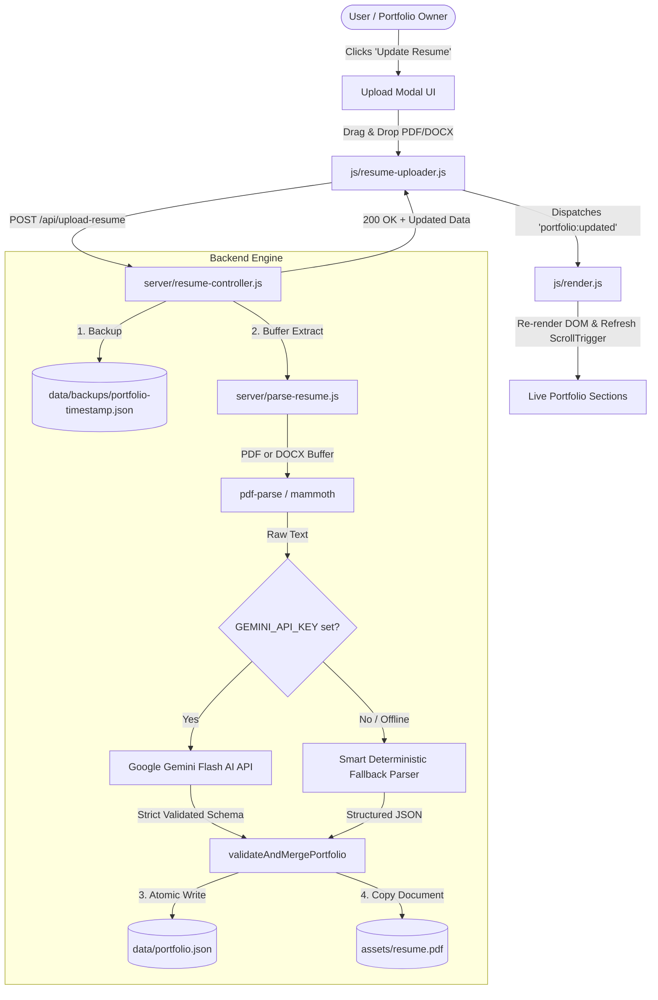

# 🤖 AI Resume-Driven Dynamic Portfolio — Documentation & User Guide

> **Official operational and developer documentation for the AI-driven resume upload, text extraction, Gemini AI schema transformation, and live portfolio auto-update system.**

---

## 1. Feature Overview

The **AI Resume Auto-Sync Engine** allows the portfolio owner to upload an updated resume document (`.pdf` or `.docx`) directly through the browser. 

The backend immediately:
1. **Creates an automated timestamped backup** of `data/portfolio.json` in `data/backups/`.
2. **Extracts text in-memory** using `pdf-parse` (for PDF) and `mammoth` (for DOCX).
3. **Passes the raw text to Google Gemini AI** (`gemini-2.5-flash`) via the `@google/genai` SDK to transform it into the strict 8-section portfolio JSON schema.
4. If an API key is not configured or offline, it activates the **deterministic rule-based parser**, ensuring zero downtime or UI breakage.
5. **Atomically saves the result** to `data/portfolio.json` and copies the uploaded resume to `assets/` so the "Download Resume" button stays in sync.
6. **Emits a real-time DOM update event** (`portfolio:updated`) that re-renders all 8 sections (Hero, About, Skills, Projects, Experience, Education, Certifications, Contact) and recalibrates GSAP ScrollTrigger without needing a hard page reload.

---

## 2. System Architecture



---

## 3. Configuration & Setup

### 3.1 Environment Variables (`.env`)
Create or edit `.env` in the root folder:

```bash
# Google Gemini API Key from Google AI Studio (https://aistudio.google.com/)
GEMINI_API_KEY=your_actual_gemini_api_key_here

# Local Web Server Port (Defaults to 3000)
PORT=3000
```

> [!NOTE]
> If `GEMINI_API_KEY` is not provided or set to default placeholder, the application automatically uses the built-in **Deterministic Regex & Rule-Based Parser**. Everything continues to function seamlessly offline.

### 3.2 Starting the Application
```bash
# Install dependencies (first time only)
npm install

# Start the high-performance static & API server
npm start
```
The server will be available at:
`http://localhost:3000`

---

## 4. How to Use the AI Resume Auto-Sync

### Method 1: Using the Website UI
1. Open the website at `http://localhost:3000`.
2. Click **"Update Resume"** in the top navigation bar, or **"AI Sync"** in the Hero section actions.
3. The glassmorphism upload dialog will appear.
4. Drag and drop your updated **PDF** or **DOCX** resume file (up to 10MB) into the drop zone, or click to browse files.
5. Click **"Analyze & Sync Portfolio"**.
6. Watch the live multi-step progress bar:
   - *Uploading document...*
   - *Extracting text and metadata...*
   - *Transforming with Google Gemini AI...*
   - *Validating schema and persisting...*
   - *Portfolio successfully updated!*
7. The dialog auto-closes and your portfolio renders the fresh content immediately.

### Method 2: Via REST API
You can programmatically trigger an update via `curl` or any API client:

```bash
curl -X POST http://localhost:3000/api/upload-resume \
  -F "resume=@/path/to/your/Resume.pdf"
```

#### Successful Response (HTTP 200 OK):
```json
{
  "success": true,
  "message": "Resume parsed and portfolio updated successfully!",
  "backup": "data/backups/portfolio-2026-11-06T04-20-00-000Z.json",
  "extractedCharacters": 1736,
  "data": {
    "profile": { ... },
    "stats": [ ... ],
    "skills": { ... },
    "projects": { ... },
    "experience": { ... },
    "education": { ... },
    "certifications": { ... },
    "contact": { ... }
  }
}
```

---

## 5. API Reference

| Endpoint | Method | Payload | Description |
| :--- | :---: | :--- | :--- |
| `/api/upload-resume` | `POST` | `multipart/form-data` (`resume` file field) | Uploads resume, backs up current state, extracts text, transforms with Gemini AI, and updates `data/portfolio.json`. |
| `/api/portfolio` | `GET` | *None* | Retrieves the active `data/portfolio.json` payload. |
| `/api/backups` | `GET` | *None* | Returns the list of all automated timestamped backups. |
| `/api/health` | `GET` | *None* | Returns server status and verifies whether Gemini API key is configured. |

---

## 6. Recovery & Automated Backups

Prior to any overwrite of `data/portfolio.json`, an automatic timestamped snapshot is archived to:
```text
data/backups/portfolio-YYYY-MM-DDTHH-mm-ss-sssZ.json
```
If you ever need to roll back to a prior state:
1. Open `data/backups/` and select the desired JSON snapshot.
2. Replace `data/portfolio.json` with that file, or fetch it via the backup management list.

---

## 7. Automated Test Suite & Verification

The project includes an end-to-end automated test runner covering 8 distinct test suites.

Run tests at any time with:
```bash
npm test
```

### Verified Test Suites:
- **Suite 1: Data Store & Resume Validation**: Verifies schema fidelity, 4 KPI stats, 5 skill categories, 4 flagship projects, 4 career roles, and verified links.
- **Suite 2: Asset Integrity**: Verifies binary PDF documents and SVG visual media.
- **Suite 3: DOM Skeleton & Navigation**: Confirms all 8 section containers (`#hero`, `#about`, `#skills`, `#projects`, `#experience`, `#education`, `#certificates`, `#contact`) and nav links.
- **Suite 4: AI Resume Modal & Component DOM**: Validates modal dialog, drag-drop zone, file input, progress bars, navbar trigger, and CSS import.
- **Suite 5: In-Memory Text Extraction & Rule Parser**: Verifies PDF buffer extraction and candidate parsing.
- **Suite 6: Local HTTP Server Endpoints**: Tests static streaming routes, MIME types, and JSON APIs.
- **Suite 7: Live Upload & Persistence Pipeline**: Executes real multipart POST request to `/api/upload-resume`, verifies automated backup creation, and atomic persistence.
- **Suite 8: Form Validation Logic**: Tests strict email regular expressions and boundary conditions.

**Result: 87 / 87 automated checks passing with 0 failures.**

