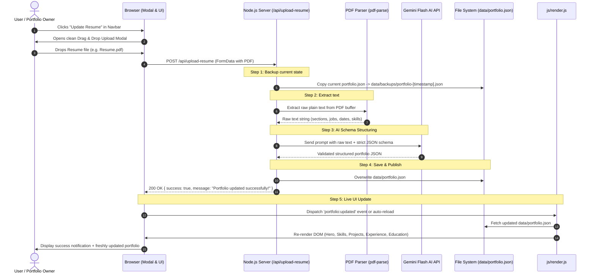

# AI Resume-Driven Dynamic Portfolio — Architecture & Implementation Plan

## 1. Executive Summary
This document outlines the complete technical design, project structure, and end-to-end system flow for an **AI Resume-Driven Dynamic Portfolio**. 

The portfolio owner can upload an updated resume (PDF or DOCX format) directly from the website via an "Upload / Update Resume" button (without requiring an admin passcode). The backend automatically extracts text, prompts Google Gemini AI to structure the content into a strict JSON schema, persists it to `data/portfolio.json`, and triggers an immediate live update of the portfolio frontend.

---

## 2. Complete Project File & Folder Structure

```text
D:\Project\Protfolio/
│
├── data/
│   ├── portfolio.json            # [DATA STORE] Active portfolio data source of truth
│   └── backups/                  # [RECOVERY] Automated timestamped JSON backups prior to each update
│
├── uploads/                      # Temporary storage for uploaded PDF/DOCX resumes
│
├── js/
│   ├── render.js                 # [DYNAMIC RENDERER] Fetches portfolio.json & injects DOM nodes
│   ├── resume-uploader.js        # [UI CONTROLLER] Handles upload modal, drag-and-drop & API progress
│   ├── main.js                   # Application bootstrap
│   ├── canvas-stream.js          # 3D canvas background animation
│   ├── navigation.js             # Smooth scroll and navigation tracking
│   └── animations.js             # GSAP & IntersectionObserver scroll triggers
│
├── css/
│   ├── components/
│   │   ├── upload-modal.css      # Upload modal & live progress status styles
│   │   ├── hero.css              # Hero section styling
│   │   ├── skills.css            # Dynamic skills chips styling
│   │   ├── projects.css          # Project cards grid styling
│   │   ├── experience.css        # Timeline component styling
│   │   └── ... (existing component stylesheets)
│   └── main.css
│
├── server/
│   ├── parse-resume.js           # PDF/DOCX text extraction + Gemini AI structured extraction
│   └── resume-controller.js      # Express / Node request handling for upload & save
│
├── index.html                    # Public portfolio + "Upload Resume" button & modal markup
├── server.js                     # Static file server + /api/upload-resume endpoint
├── package.json                  # Dependencies: multer, pdf-parse, @google/genai, etc.
├── DESIGN_SYSTEM.md              # Design tokens and visual language specifications
└── RESUME_AUTO_UPDATE_PLAN.md    # System flow and architecture documentation
```

---

## 3. End-to-End System Flow



---

## 4. Step-by-Step Flow Description

### Step 1: User Upload Trigger (Frontend)
* The user clicks the **"Update Resume"** button located in the header navigation or footer.
* An interactive modal popup appears with a drag-and-drop file target.
* The user drops their PDF or DOCX file.
* Client-side validation verifies the file extension (`.pdf`, `.docx`) and file size (`< 10MB`).

### Step 2: Upload Handling & Automated Backup (Backend)
* The client sends a `multipart/form-data` request to `POST /api/upload-resume`.
* The server immediately creates a timestamped snapshot of `data/portfolio.json` into `data/backups/portfolio-<timestamp>.json` so no data is ever lost.

### Step 3: In-Memory Text Extraction (Parser Layer)
* The server reads the uploaded file buffer.
* For PDF files: `pdf-parse` extracts raw text streams, stripping binary headers while preserving textual order.
* For DOCX files: `mammoth` extracts plain text from XML document trees.

### Step 4: AI Intelligent Data Transformation (Gemini Flash API)
* The extracted raw text is wrapped inside a specialized prompt instructing the Gemini Flash model to populate a rigid JSON schema:
  * **Profile**: Name, professional title, punchy elevator bio, location, email, social URLs.
  * **Skills**: Grouped into categorized lists (e.g., Frontend, Backend, Tools & DevOps, Core Competencies).
  * **Experience**: Company name, role title, duration/dates, and structured bullet point achievements.
  * **Projects**: Project title, category, description, tech stack tags, live link, GitHub repository.
  * **Education & Certifications**: Degrees, universities, certification titles, issuers, and years.
* Model returns strictly valid, validated JSON with no extraneous markdown backticks.

### Step 5: Persistence & Atomicity (File System)
* The server validates the AI JSON output against the required schema keys.
* If validation passes, it atomically writes the new content into `data/portfolio.json`.
* The API returns `{ success: true, data: [...] }` to the client.

### Step 6: Live DOM Injection & Re-rendering (Frontend)
* Upon receiving a 200 OK response, the modal displays a success animation.
* `js/render.js` dynamically updates DOM sections (Hero, About, Skills, Experience, Projects, Education) without full page reload, or initiates a smooth page refresh.
* Scroll animations and visual effects re-bind to new DOM elements.

---

## 5. Structured Data Schema (`data/portfolio.json`)

```json
{
  "profile": {
    "name": "Alex Morgan",
    "title": "Creative Director & Full Stack Engineer",
    "headline": "Crafting digital experiences at the intersection of design and code.",
    "bio": "Experienced designer and engineer specializing in brand strategy, digital product engineering, and interactive web experiences.",
    "location": "San Francisco, CA",
    "email": "alex@example.com",
    "socials": {
      "github": "https://github.com/...",
      "linkedin": "https://linkedin.com/in/...",
      "twitter": "https://twitter.com/..."
    }
  },
  "stats": [
    { "value": "6+", "label": "Years Experience" },
    { "value": "45+", "label": "Completed Projects" },
    { "value": "18", "label": "Industry Awards" }
  ],
  "skills": [
    {
      "category": "Frontend & Creative",
      "items": ["React", "WebGL", "Three.js", "GSAP", "Tailwind CSS"]
    },
    {
      "category": "Backend & Cloud",
      "items": ["Node.js", "PostgreSQL", "Docker", "AWS", "REST APIs"]
    }
  ],
  "experience": [
    {
      "role": "Lead Product Designer & Engineer",
      "company": "Studio Vertex",
      "location": "Remote",
      "period": "2023 — Present",
      "highlights": [
        "Architected scalable design systems reducing development cycles by 35%.",
        "Engineered real-time 3D web applications with 60fps performance."
      ]
    }
  ],
  "projects": [
    {
      "title": "Aura Canvas 3D",
      "category": "Interactive Web",
      "description": "High performance WebGL visualizer engine with real-time physics.",
      "techStack": ["Three.js", "WebGL", "GLSL", "Node.js"],
      "liveUrl": "https://example.com",
      "githubUrl": "https://github.com/..."
    }
  ],
  "education": [
    {
      "degree": "B.S. in Computer Science",
      "institution": "University of California, Berkeley",
      "year": "2018 — 2022"
    }
  ],
  "certifications": [
    {
      "title": "AWS Certified Solutions Architect",
      "issuer": "Amazon Web Services",
      "year": "2024"
    }
  ]
}
```

---

## 6. Implementation Milestones

* [ ] **Milestone 1**: Create `data/portfolio.json` with initial portfolio data and write `js/render.js` to render content dynamically.
* [ ] **Milestone 2**: Build `upload-modal.css` and `js/resume-uploader.js` for the direct drag-and-drop modal UI.
* [ ] **Milestone 3**: Setup `server/parse-resume.js` with `pdf-parse` and Gemini API extraction logic.
* [ ] **Milestone 4**: Wire the `/api/upload-resume` endpoint into `server.js` and test live upload with a real PDF resume.
