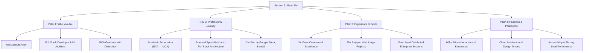

# Section 2: About Me — Content Strategy & Implementation Plan

## 1. Overview & Objective
The **About Me** section acts as the narrative core of the portfolio for **Md MatlooB Alam**. It bridges high-level positioning from the Hero section with concrete proof points found in Experience, Projects, and Education.

Its primary objectives:
1. Establish identity as a **Full Stack Developer & UI Architect**.
2. Articulate a clear **professional journey** moving from foundational computer applications to enterprise architectures.
3. Quantify **hands-on experience** (3+ years, 25+ projects) and define **forward-looking career goals**.
4. Communicate genuine **engineering passions** (fluid UI performance, design systems, clean TypeScript, accessible software).

---

## 2. Core Pillars & Narrative Architecture



---

## 3. Detailed Pillar Specifications

### Pillar 1: Who You Are
* **Name & Title:** Md MatlooB Alam — Full Stack Developer & UI Architect.
* **Core Value Proposition:** A multidisciplinary engineer who blends creative UI/UX precision with resilient, production-grade backend and cloud architecture.
* **Credentials:** Master of Computer Applications (MCA) with First Class Distinction, certified by Google (UX & Web Design), Meta (Front-End Specialization), and AWS (Cloud Practitioner).

### Pillar 2: Professional Journey
* **Phase 1: Foundations (2017–2020):** Bachelor of Computer Applications (BCA). Focused on algorithms, data structures, relational databases, and fundamental web development.
* **Phase 2: Applied Engineering (2020–2023):** Master of Computer Applications (MCA). Mastered distributed systems, design patterns, and modern client-side architectures.
* **Phase 3: Production Impact (2021–Present):** Progressed from Frontend Software Developer to Senior Frontend Engineer to Lead Full Stack Developer & UI Architect, building modular design systems and cloud-backed platforms.

### Pillar 3: Experience & Career Goals
* **Track Record:** 
  * **3+ Years** of professional engineering experience.
  * **25+ Production Applications** shipped across e-commerce, SaaS, dashboards, and enterprise tools.
  * **99% Code Quality & High-Availability** standards across production deployments.
* **Career Goals:**
  * Lead end-to-end architecture of distributed, cloud-native web applications.
  * Spearhead enterprise design systems that unify design engineering and developer velocity.
  * Contribute to open-source modern web tooling and high-scale systems.

### Pillar 4: Passions & Engineering Philosophy
* **Performance-First Design:** Ensuring sub-second load times, minimal bundle sizes, and optimal Lighthouse scores.
* **Motion & Kinematics:** Crafting natural, fluid 60fps micro-interactions and smooth scroll timelines that enrich user experience without causing layout thrashing.
* **Scalable Codebases:** Maintaining strict TypeScript typing, decoupled component contracts, and clean RESTful / GraphQL API architectures.
* **Human-Centric Accessibility:** Building inclusive digital products compliant with WCAG 2.1 AA accessibility guidelines.

---

## 4. Copywriting Variants

### Variant 1: Live Portfolio Story Card (Active in `index.html`)
> "I am **Md MatlooB Alam**, a Full Stack Developer & UI Architect with a Master’s in Computer Applications (MCA). My professional journey started with foundational software engineering and evolved into architecting resilient full-stack systems, modular component libraries, and cloud-native solutions.
>
> With over **3+ years** of hands-on experience delivering 25+ web and application projects, my career goal is to architect large-scale distributed systems and lead design-engineering initiatives that set new standards in software quality.
>
> I am deeply passionate about the intersection of design precision and technical performance: fluid 60fps micro-interactions, clean TypeScript architecture, accessible UX, and blazing-fast load times."

### Variant 2: Concise Resume Summary
> "Results-driven Full Stack Developer & UI Architect (MCA) with 3+ years of experience engineering high-performance web applications and scalable cloud backends. Proven record of delivering 25+ projects with 99% uptime and clean code quality. Certified by Meta, Google, and AWS. Passionate about design systems, fluid micro-interactions, and distributed architectures."

### Variant 3: 30-Second Elevator Pitch
> "I bridge the gap between creative UI and scalable full stack engineering. Whether crafting 60fps responsive interfaces in React/Next.js or architecting high-throughput REST APIs and database layers with Node.js and PostgreSQL, I turn complex requirements into smooth, reliable, production-ready software."

---

## 5. UI Component & Interaction Design

The About Me section is structured with a two-column glassmorphism layout:

1. **Left Column — Story Card:**
   * **Live Status Pill:** Glowing pulsing indicator stating *"Available for freelance & full-time roles"*.
   * **Headline:** Bold heading establishing the design-engineering bridge.
   * **Narrative Body:** 3 focused paragraphs addressing identity, trajectory, goals, and passions.
   * **Primary Action CTA:** *"Let's collaborate"* button with interactive arrow circle linking directly to `#contact`.

2. **Right Column — Metrics Counter Grid:**
   * `03+` — Years of Experience
   * `25+` — Web & App Projects
   * `10+` — Modern Tech Stacks
   * `99%` — Code Quality & Uptime

---

## 6. Dynamic JSON Data Contract (for AI Resume Sync)

When integrated with the automated resume parser (`RESUME_AUTO_UPDATE_PLAN.md`), the About section maps directly to the following JSON schema in `data/portfolio.json`:

```json
{
  "about": {
    "status": "Available for freelance & full-time roles",
    "subheading": "Bridging Creative UI with Scalable Full Stack Engineering",
    "paragraphs": [
      "I am Md MatlooB Alam, a Full Stack Developer & UI Architect with a Master’s in Computer Applications (MCA). My professional journey started with foundational software engineering and evolved into architecting resilient full-stack systems, modular component libraries, and cloud-native solutions.",
      "With over 3+ years of hands-on experience delivering 25+ web and application projects, my career goal is to architect large-scale distributed systems and lead design-engineering initiatives that set new standards in software quality.",
      "I am deeply passionate about the intersection of design precision and technical performance: fluid 60fps micro-interactions, clean TypeScript architecture, accessible UX, and blazing-fast load times."
    ],
    "metrics": [
      { "number": "03+", "label": "Years of Experience" },
      { "number": "25+", "label": "Web & App Projects" },
      { "number": "10+", "label": "Modern Tech Stacks" },
      { "number": "99%", "label": "Code Quality & Uptime" }
    ]
  }
}
```

---

## 7. Verification & Quality Checklist
- [x] Clear identity stated (Md MatlooB Alam, Full Stack Developer & UI Architect).
- [x] Educational journey reflected (BCA & MCA).
- [x] Quantifiable experience highlighted (3+ years, 25+ projects).
- [x] Career ambitions defined (leading architecture and high-impact distributed products).
- [x] Passions articulated (micro-interactions, design systems, performance, accessibility).
- [x] Mobile responsive glassmorphic cards and accessible contrast ratios maintained.
