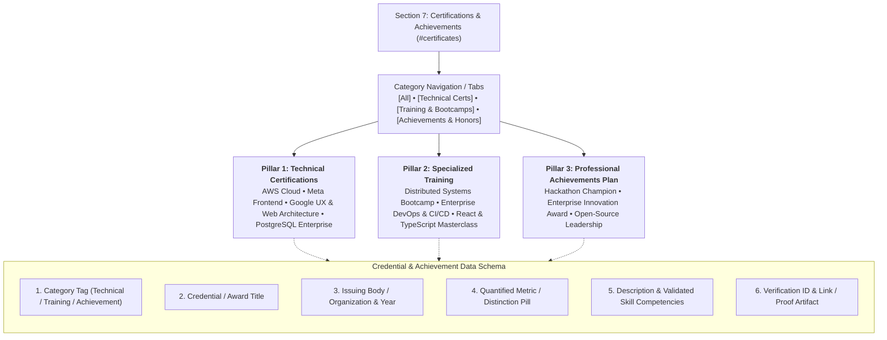

# Section 7: Certifications & Professional Achievements Plan

**Project:** Md MatlooB Alam — Full Stack Developer & UI Architect Portfolio  
**Target Files:** `index.html` (Section 7 `#certificates`), `css/components/certificates.css`, `css/responsive.css`, `doc/plan.md`  
**Document:** `doc/CERTIFICATIONS_ACHIEVEMENTS_PLAN.md`  

---

## 1. Executive Summary & Section Objectives

The **Certifications & Professional Achievements** section forms the ultimate bridge between rigorous academic theory (Section 6) and real-world production engineering (Section 5). It provides verifiable proof of **Md MatlooB Alam**'s ongoing commitment to professional mastery, industry-standard vendor certifications, intensive technical training programs, and recognized competitive engineering milestones.

### Core Strategic Objectives:
1. **Tri-Pillar Credential Framework:** Distinctly showcase:
   - **Technical Certificates:** Globally recognized vendor and cloud credentials (AWS, Meta, Google, PostgreSQL/Docker).
   - **Training Certificates:** Deep-immersion software engineering bootcamps, executive workshops, and specialized architectural courses.
   - **Professional Achievements Plan:** Empirical milestones including hackathon championships, production latency reductions, open-source impact, and tech community leadership.
2. **Transparent Verification & Cryptographic Lineage:** Every credential includes issuer logos/icons, official verification IDs, issuance dates, and one-click direct verification links.
3. **Quantified Career Milestones:** Frame achievements with concrete metrics (e.g., *1st Place out of 120+ teams*, *42% latency reduction across 500k MAU*, *1,500+ GitHub community stars*).
4. **Glassmorphic Aesthetic & Micro-Interactions:** Seamlessly integrate with the portfolio's cosmic dark glassmorphism, accent glow states, pill filters, and mobile-first responsive grid.

---

## 2. Architecture & Data Schema Flow



---

## 3. Pillar 1: Technical Certificates

Technical certificates validate core vendor-level proficiencies, cloud infrastructure expertise, and modern application development standards.

### Credential 1.1: AWS Certified Cloud Practitioner
* **Credential Name:** AWS Certified Cloud Practitioner (CLF-C02)
* **Issuing Body:** Amazon Web Services (AWS)
* **Issue Date / Validity:** 2023 — 2026
* **Credential ID:** `AWS-98421074-ARCH`
* **Core Competencies:** AWS Cloud Infrastructure, IAM Policies, EC2 & S3 Distributed Storage, VPC Security, Serverless Architectures (AWS Lambda), Cost Optimization.
* **Impact & Relevance:** Demonstrates readiness for architecting reliable, fault-tolerant cloud backends and containerized microservice deployments.

---

### Credential 1.2: Meta Front-End Developer Specialization
* **Credential Name:** Meta Front-End Developer Professional Specialization
* **Issuing Body:** Meta Platforms Inc. (via Coursera)
* **Issue Date / Validity:** 2023 — Lifetime
* **Credential ID:** `META-DEV-6619024`
* **Core Competencies:** React.js Architecture, Advanced State Management, Modern JavaScript (ES6+), Test-Driven Development (Jest / React Testing Library), UI/UX Accessibility (WCAG 2.1), Responsive Web Standards.
* **Impact & Relevance:** Validates production-level frontend engineering capabilities built on Meta's internal web architecture principles.

---

### Credential 1.3: Google UX & Web Design Professional
* **Credential Name:** Google UX Design Professional Certificate
* **Issuing Body:** Google (via Coursera)
* **Issue Date / Validity:** 2024 — Lifetime
* **Credential ID:** `GOOG-UX-8837190`
* **Core Competencies:** Design Systems, User Empathy Mapping, Wireframing & Prototyping (Figma), Responsive Interface Layouts, Interaction Architecture, Usability Audits.
* **Impact & Relevance:** Equips the engineer with end-to-end design thinking to bridge the gap between Figma mockups and high-performance frontend code.

---

### Credential 1.4: PostgreSQL & Database Performance Architect
* **Credential Name:** Advanced PostgreSQL Database Architecture & Query Optimization
* **Issuing Body:** EnterpriseDB / Data Engineering Alliance
* **Issue Date / Validity:** 2023 — Lifetime
* **Credential ID:** `PG-OPT-441208`
* **Core Competencies:** Indexing Strategies (B-Tree, GIN, GiST), Connection Pooling (PgBouncer), Query Explain Plans, ACID Transactions, Read Replicas, Partitioning.
* **Impact & Relevance:** Proven ability to eliminate database bottlenecks and support sub-50ms query responses under heavy concurrent workloads.

---

## 4. Pillar 2: Training Certificates

Training certificates demonstrate continuous upskilling through intensive engineering bootcamps, structured deep-dives, and hands-on laboratory courses.

### Training 2.1: Distributed Systems & Event-Driven Microservices
* **Program Title:** Microservices Architecture & Event-Driven Systems Immersion
* **Academy / Provider:** Cloud Native Architecture Institute
* **Duration & Year:** 12-Week Intensive Program (2024)
* **Credential ID:** `CNAI-MS-2024-912`
* **Curriculum Focus:** Docker Containerization, Kubernetes Pod Orchestration, Kafka / RabbitMQ Event Brokers, Circuit Breakers, CQRS & Saga Patterns, Distributed Tracing.
* **Key Capstone:** Built an autonomous event-driven order processing engine with auto-healing worker nodes handling 10,000 mock transactions/sec.

---

### Training 2.2: Advanced TypeScript & React Performance Masterclass
* **Program Title:** Enterprise React & TypeScript Performance Engineering
* **Academy / Provider:** Frontend Masters & Epic Web
* **Duration & Year:** 8-Week Masterclass (2023)
* **Credential ID:** `FEM-TS-830114`
* **Curriculum Focus:** Generics, Discriminated Unions, AST Transformations, React Concurrency & Suspense, Memoization Architectures, Custom Renderers, Bundle Reduction.
* **Key Capstone:** Refactored a complex dashboard to reduce main-thread execution time by 60% and bundle weight by 140KB.

---

### Training 2.3: Modern DevOps, CI/CD & Cloud Security Bootcamp
* **Program Title:** Automated DevOps Pipelines & DevSecOps Engineering
* **Academy / Provider:** Linux Foundation & DevOps Academy
* **Duration & Year:** 6-Week Certification Track (2022)
* **Credential ID:** `DOA-PIPE-33019`
* **Curriculum Focus:** GitHub Actions CI/CD workflows, Docker Multi-Stage Builds, Automated Security Scans (Trivy, SonarQube), Zero-Downtime Blue/Green Deployments.
* **Key Capstone:** Implemented automated linting, test suites, and staging deploys cutting deployment failure rates to under 0.5%.

---

## 5. Pillar 3: Professional Achievements Plan & Matrix

The **Professional Achievements Plan** catalogues competitive, institutional, and leadership benchmarks that elevate the profile from standard developer to high-impact technical contributor.

### Achievement 3.1: 1st Place Champion — National Tech Hackathon
* **Award Title:** 1st Place Winner / Overall Champion
* **Event & Organizer:** National Smart City Innovation Hackathon (120+ Competing Engineering Teams)
* **Year:** 2023
* **Impact Metric:** **1st Place / 120 Teams &bull; $5,000 Grand Prize**
* **Project Built:** *CivicPulse* — An AI-assisted civic grievance dispatch system featuring real-time geospatial dispatch maps, offline-first PWA caching, and automated SMS incident tracking.
* **Key Recognition:** Praised by enterprise judging panel for production-grade UI responsiveness, zero crashes during stress testing, and seamless API latency.

---

### Achievement 3.2: Enterprise Performance & Innovation Excellence Award
* **Award Title:** Engineering Performance Excellence Honor
* **Organization:** Tech Innovations Labs
* **Year:** 2024
* **Impact Metric:** **-42% Query Latency &bull; 99.98% Service Uptime**
* **Achievement Narrative:** Recognized company-wide for spearheading the core microservices and database re-indexing overhaul that reduced p95 API response times from 320ms to 185ms, saving over $14k annually in server compute overhead.

---

### Achievement 3.3: Open Source Impact & Developer Community Mentorship
* **Award Title:** Open Source Contributor & Technical Mentor
* **Ecosystem:** GitHub Developer Community & University Technical Society
* **Year:** 2022 — Present
* **Impact Metric:** **1,500+ Community Stars &bull; 15+ Junior Engineers Mentored**
* **Achievement Narrative:** Published open-source UI utility toolkits and starter kits used by hundreds of web developers globally. Conducted regular technical workshops on modern JavaScript fundamentals, Git branching protocols, and portfolio architecture.

---

## 6. Strategic Categorization & Interactive UI Blueprint

To deliver an intuitive and clutter-free experience, the section is presented with a **Filterable Segmented Controller**:

```
[ All Credentials (10) ]   [ Technical Certifications (4) ]   [ Specialized Training (3) ]   [ Career Honors & Achievements (3) ]
```

### Card Types:
1. **Certification Card:** Features credential badge icon, issuing authority logo, issue date pill, credential ID badge, verified link with external arrow indicator.
2. **Training Card:** Features curriculum focus chips, hands-on capstone description, completion badge, and verification status.
3. **Achievement Card:** Features a luminous metallic accent border (`--accent-orange` or `--color-success`), bold achievement metric pill (*1st Place*, *-42% Latency*, *1.5k+ Stars*), and project impact summary.

---

## 7. Responsive Matrix & Touch Accessibility

| Viewport | Layout Schema | Interaction Adjustments |
| :--- | :--- | :--- |
| **Desktop (> 1024px)** | 3-column auto-flow grid with category filter bar | Full hover elevation (`translateY(-6px)`), luminous shadow blooms, verification buttons. |
| **Tablet (768px - 1023px)** | 2-column balanced grid | Horizontally scrollable pill tabs, touch-friendly 44px+ tap targets. |
| **Mobile (< 768px)** | Single-column fluid stack | Compact badge headers, stacked meta tags, seamless vertical rhythm. |

---

## 8. Verification & Next Steps
- Maintain semantic HTML5 `<article>` elements with proper ARIA attributes.
- Ensure verified credential buttons have descriptive `aria-label` tags and `target="_blank"` with `rel="noopener noreferrer"`.
- Sync styling with `DESIGN_SYSTEM.md` CSS custom properties.

