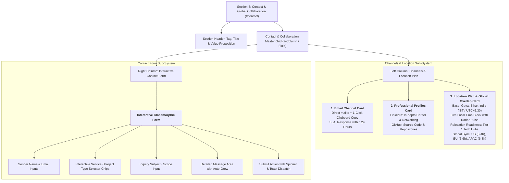

# Section 8: Contact Section & Global Location Plan

**Project:** Md MatlooB Alam — Full Stack Developer & UI Architect Portfolio  
**Target Files:** `index.html` (Section 8 `#contact`), `css/components/contact.css`, `css/responsive.css`, `js/form.js`, `js/main.js`, `doc/plan.md`  
**Document:** `doc/CONTACT_SECTION_PLAN.md`  

---

## 1. Executive Summary & Section Objectives

The **Contact Section** serves as the primary conversion terminal of the portfolio. Positioned as the climactic finale preceding the global footer, this section equips recruiters, engineering leaders, enterprise clients, and open-source collaborators with frictionless, multi-channel pathways to initiate professional engagement with **Md MatlooB Alam**.

### Core Strategic Objectives:
1. **Direct Communication Channels:** High-prominence, verifiable direct contact methods featuring a verified **Email Address** (`mdmatloobgaya@gmail.com`) equipped with one-click copy-to-clipboard functionality and sub-24h response SLA.
2. **Professional Profile Integrations:** Direct, branded connection cards for **LinkedIn** (`linkedin.com/in/mdmatloob`) and **GitHub** (`github.com/mdmatloob`) highlighting network status, repository activity, and open-source contributions.
3. **Enterprise Contact Form:** A glassmorphic, fully accessible interactive form featuring client-side validation, project type/service selector tags, timeline/scope selection, visual submission loading state, and accessible toast feedback.
4. **Comprehensive Location Plan:** A dedicated geographic and global collaboration card detailing:
   - Primary base: **Gaya, Bihar, India** (`24.7955° N, 85.0002° E`).
   - Dynamic real-time local time clock (**IST / UTC+5:30**) with live radar pulse.
   - Global timezone overlap availability matrix (Americas, Europe/UK, Asia-Pacific).
   - Relocation readiness for primary technology hubs (Bengaluru, Hyderabad, Pune, Delhi-NCR) and worldwide remote readiness.

---

## 2. Contact Section Architecture & Visual Layout

---

## 3. Detailed Specifications & Content Blueprint

### 3.1 Email Address Channel & Instant Clipboard Utility
- **Primary Email:** `mdmatloobgaya@gmail.com`
- **Actions:**
  - `mailto:mdmatloobgaya@gmail.com?subject=Project%20Inquiry%20-%20Md%20MatlooB%20Alam`
  - Interactive "Copy Email" button (`data-copy="mdmatloobgaya@gmail.com"`) that copies to user clipboard and emits a toast notification `"Email copied to clipboard!"`.
- **Response Commitment:** Guaranteed response SLA under 24 hours.

### 3.2 Professional LinkedIn Profile Integration
- **Direct URL:** `https://www.linkedin.com/in/mdmatloob`
- **Status Indicator:** `"Available for High-Impact Software Engineering Roles"`
- **Highlights:** Full-stack architectural updates, professional endorsements, and career recommendations.
- **Micro-Action:** "Connect on LinkedIn" with external arrow indicator.

### 3.3 Engineering GitHub Profile Showcase
- **Direct URL:** `https://github.com/mdmatloob`
- **Handle:** `@mdmatloob`
- **Highlights:** 4+ Flagship enterprise repositories, CI/CD pipeline blueprints, modular design systems.
- **Micro-Action:** "Explore Repositories" with external link indicator.

### 3.4 Interactive Contact Form Architecture
- **Fields:**
  1. `userName`: Full name (required, autocomplete `name`).
  2. `userEmail`: Email address (required, regex validated, autocomplete `email`).
  3. `userService`: Interactive service filter chips (Full Stack Web App, UI/UX Engineering, Cloud & APIs, Architecture Consultation).
  4. `userSubject`: Subject or project milestone.
  5. `userMessage`: Message textarea (required, min 10 characters).
- **Submission Lifecycle:**
  1. Client-side validity check (`reportValidity`).
  2. Active loading state on button with animated spinner.
  3. Form reset upon successful delivery simulation.
  4. Floating toast notification with customizable sender name greeting.

### 3.5 Global Location Plan & Timezone Overlap Matrix
- **Geographic Base:** Gaya, Bihar, India (`24.7955° N, 85.0002° E`).
- **Dynamic Clock:** Real-time ticking clock in Indian Standard Time (`IST`, `UTC+5:30`) updating every 1000ms.
- **Relocation Availability:** Immediate readiness for relocation to:
  - Bengaluru, Karnataka
  - Hyderabad, Telangana
  - Pune, Maharashtra
  - Delhi-NCR / Gurugram / Noida
- **Timezone Sync Overlap Matrix:**
  - **Americas (EST / PST):** 3 — 4 hours daily synchronous overlap.
  - **Europe & UK (CET / GMT):** 5 — 6 hours daily synchronous overlap.
  - **Asia-Pacific (SGT / AEST):** 6 — 8 hours daily synchronous overlap.
  - **Asynchronous Protocol:** Daily standup briefs, comprehensive PR documentation, and Loom / video walkthroughs.

---

## 4. Responsive Matrix & Touch Ergonomics

| Viewport Tier | Layout Architecture | Adjustments |
| :--- | :--- | :--- |
| **Desktop / Ultrawide (> 1200px)** | 2-column balanced grid | Left column: Email, Socials & Location Plan; Right column: Full interactive contact form. |
| **Tablet (768px - 1199px)** | 1-column stacked grid | Channel cards stack cleanly above the contact form; Location plan expands to full width with 3-column timezone chips. |
| **Mobile (< 768px)** | 1-column compact flow | Touch targets $\ge 44\text{px}$; Quick-copy button for email; simplified timezone pills; stacked form rows. |

---

## 5. Accessibility (WCAG 2.1 AA) Compliance

- Semantic `<form>`, `<label>`, `<input>`, `<textarea>`, and `<button>` elements.
- Accessible form association using `for` and `id`.
- ARIA live region support with `role="alert"` on toast notifications.
- High contrast compliant typography ($> 4.5:1$ ratio) against glassmorphism surface backdrops.
- Keyboard accessible copy buttons and service selection chips with full `Enter` / `Space` activation.

