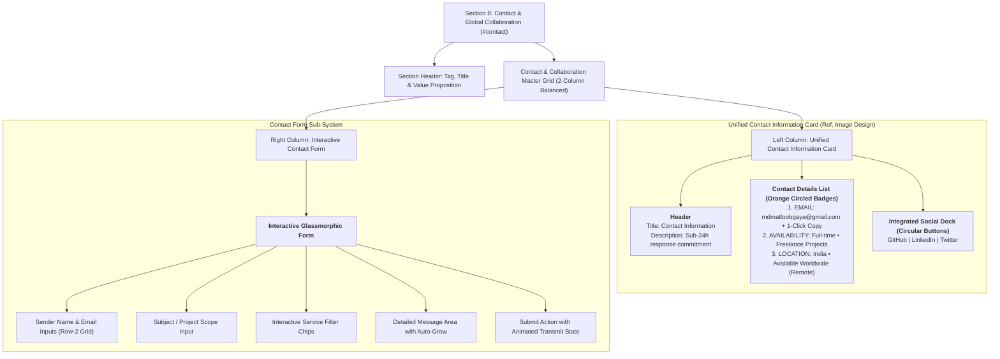

# Section 8: Contact Section & Global Collaboration Architecture

**Project:** Md MatlooB Alam — Full Stack Developer & UI Architect Portfolio  
**Target Files:** `data/portfolio.json` (`contact`), `js/render.js` (`renderContact()`), `css/components/contact.css`, `js/form.js`, `doc/plan.md`  
**Document:** `doc/CONTACT_SECTION_PLAN.md`  
**Status:** Implemented & Verified (Unified Dark Glass Contact Information Card)

---

## 1. Executive Summary & Section Objectives

The **Contact Section** serves as the primary conversion terminal of the portfolio. Positioned as the climactic finale preceding the global footer, this section equips recruiters, engineering leaders, enterprise clients, and open-source collaborators with frictionless, multi-channel pathways to initiate professional engagement with **Md MatlooB Alam**.

### Core Strategic Objectives:
1. **Unified Left-Side Contact Information Card:** High-prominence, verifiable direct contact methods featuring a verified **Email Address** (`mdmatloobgaya@gmail.com`) with instant clipboard copy utility, transparent **Availability** status, and global **Location** reach.
2. **Integrated Circular Social Dock:** Elegant circular icon buttons for **GitHub**, **LinkedIn**, and **Twitter/X** embedded directly at the bottom of the left information card with platform-specific hover illumination.
3. **Enterprise Contact Form:** A 3D glassmorphic, fully accessible interactive form featuring client-side validation, project type selector tags, responsive dual-column layout, and accessible toast feedback.
4. **Cohesive Visual Balance:** Equalized padding, matching corner radii (`20px`), lightweight cyber-glass backdrop blur (`backdrop-filter: blur(20px)`), and orange accent kinematics (`#ff5722`).

---

## 2. Contact Section Architecture & Visual Layout

---

## 3. Detailed Specifications & Content Blueprint

### 3.1 Contact Information Card (Left Side)
- **Header:**
  - **Title:** `Contact Information`
  - **Subtitle / Description:** `Feel free to reach out via email or through social platforms. I typically respond within 24 hours.`
- **Detail Items:**
  1. **EMAIL:**
     - Icon: Circular badge with orange border (`rgba(255, 87, 34, 0.45)`) and mail envelope SVG.
     - Value: `mdmatloobgaya@gmail.com`
     - Action: One-click copy button (`id="copyEmailBtn"`) + direct `mailto:` link.
  2. **AVAILABILITY:**
     - Icon: Circular badge with orange border and phone receiver SVG.
     - Value: `Full-time • Freelance Projects`
  3. **LOCATION:**
     - Icon: Circular badge with orange border and map pin SVG.
     - Value: `India • Available Worldwide (Remote)`
- **Social Dock (Bottom Row):**
  - Horizontal dock with rounded circular buttons.
  - Platforms: **GitHub** (`github.com/mdmatloob`), **LinkedIn** (`linkedin.com/in/mdmatloob`), **Twitter** (`twitter.com/mdmatloob`).
  - Hover kinematics: lift (`translateY(-2px)`), glow shadow, and brand-accurate tinting.

### 3.2 Interactive Contact Form Architecture (Right Side)
- **Fields:**
  1. `userName`: Full name (required, autocomplete `name`).
  2. `userEmail`: Email address (required, regex validated, autocomplete `email`).
  3. `userSubject`: Inquiry subject or project milestone.
  4. `userService`: Interactive project scope chips (Full-Stack Web App, FastAPI & Django REST APIs, React Dashboards, Cloud Deployment).
  5. `userMessage`: Message textarea (required, min 10 characters).
- **Submission Lifecycle:**
  1. Client-side validity verification (`form.checkValidity()`).
  2. Transmit button spinner & animation state.
  3. Form reset upon successful delivery simulation.
  4. Floating toast notification with customizable greeting.

---

## 4. Responsive Matrix & Touch Ergonomics

| Viewport Tier | Layout Architecture | Adjustments |
| :--- | :--- | :--- |
| **Desktop / Ultrawide (> 900px)** | 2-column balanced grid (`1fr 1.25fr`) | Unified Contact Information card on left; Interactive contact form on right; equal heights. |
| **Tablet (600px - 899px)** | 1-column stacked flow | Information card cleanly stacks above the contact form; full width with generous spacing. |
| **Mobile (< 600px)** | 1-column compact flow | Touch targets $\ge 44\text{px}$; compact icon sizes ($40\text{px}$); stacked form rows; touch-friendly social dock. |

---

## 5. Accessibility (WCAG 2.1 AA) Compliance

- Semantic `<section>`, `<form>`, `<label>`, `<input>`, `<textarea>`, and `<button>` elements.
- Accessible association between inputs and labels via matching `for` and `id`.
- ARIA live region support with `role="alert"` for clipboard notifications and status banners.
- High contrast compliant typography ($> 4.5:1$ ratio) against dark glass surfaces.
- Fully keyboard-navigable social links and copy actions with standard `Tab` / `Enter` / `Space` support.
