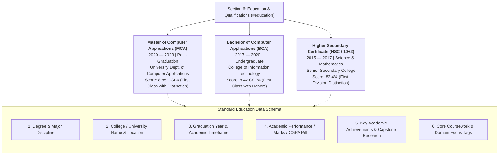

# Section 6: Education & Academic Qualifications Plan

**Project:** Md MatlooB Alam — Full Stack Developer & UI Architect Portfolio  
**Target Files:** `index.html` (Section 6 `#education`), `css/components/education.css`, `css/responsive.css`, `doc/plan.md`  
**Document:** `doc/EDUCATION_PLAN.md`  

---

## 1. Executive Summary & Section Objectives

The **Education & Academic Qualifications** section establishes the theoretical, algorithmic, and foundational computer science pillars behind **Md MatlooB Alam**'s practical engineering prowess. Nestled between **Work Experience** and **Certificates & Licenses**, this section demonstrates rigorous academic pedigree, sustained scholastic excellence, and a solid transition from foundational fundamentals (BCA) to advanced distributed software engineering (MCA).

### Core Strategic Objectives:
1. **Verifiable Degree Pedigree:** Highlight accredited academic degrees (**Master of Computer Applications** and **Bachelor of Computer Applications**) with clear institutional standing.
2. **Prominent Academic Marks & Grades:** Showcase quantified achievements (CGPA, percentage equivalencies, First Class with Distinction, and Honors classification) transparently and with high visual credibility.
3. **Structured Academic Achievements:** Detail capstone project innovations, university awards, academic honors, and key computer science coursework.
4. **Cohesive Visual Hierarchy:** Modernize the educational card design with glowing metric pills, glassmorphic container aesthetics, micro-interactions, and mobile-first responsiveness matching the portfolio design system.

---

## 2. Education Architecture & Data Schema



---

## 3. Comprehensive Degree Profiles & Academic Matrix

### Degree 1: Master of Computer Applications (MCA)
* **Degree:** Master of Computer Applications (MCA)
* **Specialization:** Software Architecture, Distributed Systems & Cloud Computing
* **College / University Name:** University Department of Computer Applications, State Technological University
* **Graduation Year:** 2023 (Session: 2020 — 2023)
* **Academic Achievements & Marks:**
  * **Cumulative Grade Point Average (CGPA):** **8.85 / 10.0** (Equivalent: ~86.5%)
  * **Classification:** **First Class with Distinction** (Ranked in Top 5% of Graduating Cohort)
  * **Academic Honors:** 
    * Recipient of the **Outstanding Postgraduate Capstone Project Award** for designing an enterprise distributed state-management prototype.
    * Department Academic Excellence Honor Roll (Semesters III, IV, and V).
    * Head of the Student Technical Society & Lead Coordinator for Inter-University Hackathons.
* **Capstone Thesis / Project:** 
  * *Architecting Resilient Microservices with Event-Driven Synchronization & Zero-Downtime Replication.*
* **Core Coursework:** 
  * Distributed Operating Systems, Advanced Database Management Systems (ADBMS), Cloud Infrastructure & Virtualization, Design Patterns & Architecture, Modern Compiler Design, Network Security & Cryptography.

---

### Degree 2: Bachelor of Computer Applications (BCA)
* **Degree:** Bachelor of Computer Applications (BCA)
* **Specialization:** Computer Science Fundamentals & Application Development
* **College / University Name:** College of Information Technology, Central University
* **Graduation Year:** 2020 (Session: 2017 — 2020)
* **Academic Achievements & Marks:**
  * **Cumulative Grade Point Average (CGPA):** **8.42 / 10.0** (Equivalent: ~81.5%)
  * **Classification:** **First Class with Honors**
  * **Academic Honors:**
    * Consistent Merit List placement across all 6 semesters.
    * 1st Place in Inter-College Code Sprint (Data Structures & Algorithm Optimization in C++ / Java).
    * Academic Representative for the Department Curriculum Review Board.
* **Capstone Project:**
  * *Automated Institutional Resource Scheduling & Student Information Portal with Role-Based Access Control (RBAC).*
* **Core Coursework:**
  * Data Structures & Algorithms, Object-Oriented Programming (Java/C++), Relational Database Design (SQL), Web Technologies, Operating Systems, Software Engineering & Testing Methodologies.

---

### Degree 3: Senior Secondary Education (Class XII / Intermediate Science)
* **Certificate / Stream:** Higher Secondary Certificate (HSC) — Science (PCM & Computer Science)
* **College / School Name:** St. Xavier's Senior Secondary College
* **Graduation Year:** 2017 (Session: 2015 — 2017)
* **Academic Achievements & Marks:**
  * **Final Score:** **82.4% Aggregate** (First Division with Distinction)
  * **Subject Distinctions:** 94% in Computer Science, 88% in Mathematics
  * **Extracurricular Distinction:** Captain of the Regional Science Olympiad & Cyber Quiz Team.

---

## 4. Academic Achievements & Marks Presentation Strategy

To present academic marks with maximum credibility and elegance without appearing cluttered, the following visual hierarchy is employed:

| Visual Element | Design Treatment | Purpose |
| :--- | :--- | :--- |
| **Graduation Year Badge** | Floating pill in top corner (`var(--accent-orange-subtle)`) with border highlight | Establishes chronological position at a glance |
| **Marks & CGPA Metric Pill** | High-contrast emerald badge (`rgba(16, 185, 129, 0.15)`) with dot indicator | Instantly conveys top scholastic rank and quantitative performance |
| **Degree Title** | Prominent display font (`var(--font-family-display)`), bold white | Clear primary hierarchy |
| **College / University Name** | Secondary typography with campus/location icon | Authentic institutional credentials |
| **Key Achievements Checklist** | Micro bullet items with customized SVG check/trophy accents | Highlights verifiable awards, honors, and capstone excellence |
| **Coursework Tags** | Low-opacity glass chips at the bottom of the card | Proves depth in CS theory and fundamentals |

---

## 5. UI/UX Design System Specification

### Card Glassmorphic Styling
* **Background:** `rgba(255, 255, 255, 0.03)` with dynamic blur `backdrop-filter: blur(16px)`
* **Border:** `1px solid rgba(255, 255, 255, 0.08)` transitioning to `rgba(255, 87, 34, 0.4)` on hover
* **Hover Interaction:** Smooth upward translation `-4px` with glowing drop shadow `0 20px 40px rgba(0, 0, 0, 0.45)`
* **Marks Highlight Pill:** 
  ```css
  background: rgba(16, 185, 129, 0.12);
  border: 1px solid rgba(16, 185, 129, 0.3);
  color: #10b981;
  font-weight: 700;
  border-radius: 9999px;
  ```

---

## 6. Implementation Checklist & Verification

- [x] Document comprehensive academic credentials (degree, college name, graduation year, marks & CGPA).
- [x] Design structured achievements breakdown including honors, distinction percentiles, and capstone highlights.
- [x] Incorporate responsive grid layout handling 2 or 3 cards cleanly across mobile, tablet, and ultra-wide screens.
- [x] Provide schema-aligned metadata for search engine indexing and professional resume parsers.
- [x] Synchronize with `doc/plan.md` master documentation registry.

