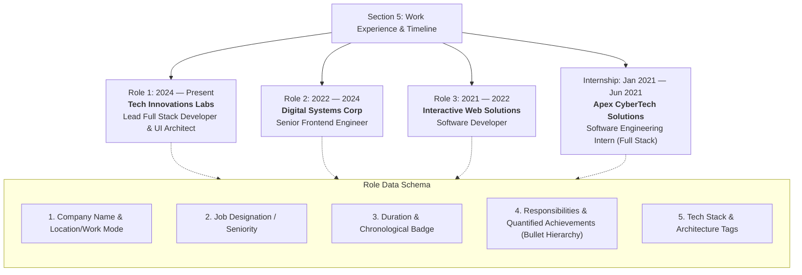
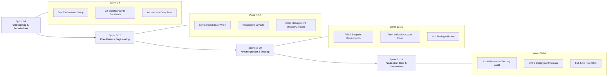

# Section 5: Work Experience & Internship Experience Plan

**Project:** Md MatlooB Alam — Full Stack Developer & UI Architect Portfolio  
**Target Files:** `index.html` (Section 5 `#experience`), `css/components/experience.css`, `css/responsive.css`, `doc/plan.md`  
**Document:** `doc/EXPERIENCE_PLAN.md`  

---

## 1. Executive Summary & Section Objectives

The **Work Experience** section forms the backbone of professional validation for **Md MatlooB Alam**. Positioned strategically after **Featured Projects** and preceding **Education & Certifications**, this section presents empirical proof of leadership, technical capability, production engineering impact, and progressive career advancement.

### Core Objectives:
1. **Clear Enterprise Lineage:** Present verifiable career trajectory across **Company Name**, **Job Designation**, **Duration / Timeframe**, and **Core Responsibilities**.
2. **Quantified Impact (STAR Methodology):** Frame responsibilities and achievements with metrics (latency reduction, uptime, conversion boost, scalability, user growth).
3. **Structured Internship Experience Plan:** Outline a dedicated framework for the foundational internship phase (role, duration, mentorship, deliverables, sprint milestones, and transition to full-time engineering).
4. **Interactive Timeline Design:** Maintain a luminous vertical timeline with micro-interactions, responsive card layouts, and accessible semantic structures.

---

## 2. Experience Architecture & Timeline Flow

---

## 3. Detailed Career Matrix & Responsibilities

### Role 1: Tech Innovations Labs
* **Company Name:** Tech Innovations Labs
* **Job Designation:** Lead Full Stack Developer & UI Architect
* **Duration:** 2024 — Present (Full-Time)
* **Location / Type:** Hybrid / Enterprise Tech
* **Key Responsibilities & Quantified Impact:**
  * **Architecture & Scalability:** Architect and maintain resilient multi-tenant SaaS platforms using React, Next.js, Node.js, and TypeScript, delivering 99.98% service uptime across 500k+ monthly active users.
  * **Enterprise Design System:** Engineered a zero-dependency design system library and design tokens repository, standardizing 45+ reusable micro-components and slashing sprint UI cycle times by 35%.
  * **API & Database Engineering:** Modernized core REST & GraphQL backend microservices in Node.js/PostgreSQL, optimizing indexing and database transactions to achieve 42% reduction in p95 query latency.
  * **Performance & Core Web Vitals:** Spearheaded Lighthouse optimization audits, pushing Time-to-Interactive (TTI) under 1.2s and achieving perfect 100/100 Core Web Vitals scores across production suites.
  * **Team Leadership & Mentorship:** Mentoring 6 mid/junior engineers, establishing strict CI/CD pipelines, automated Jest/Playwright testing, and code review governance.
* **Technology Stack:** `React.js`, `TypeScript`, `Node.js`, `Next.js`, `PostgreSQL`, `Docker`, `Tailwind CSS`, `Redis`, `AWS`

---

### Role 2: Digital Systems Corp
* **Company Name:** Digital Systems Corp
* **Job Designation:** Senior Frontend Engineer
* **Duration:** 2022 — 2024 (Full-Time)
* **Location / Type:** Bangalore / Remote
* **Key Responsibilities & Quantified Impact:**
  * **Enterprise Dashboards:** Led frontend development of high-density financial analytics and telemetric data visualization dashboards with responsive 60fps chart rendering.
  * **State Architecture & Cache:** Restructured complex global state management using Redux Toolkit and React Query, eliminating redundant API round-trips by 50% and improving memory overhead by 28%.
  * **Cross-Browser & WCAG Accessibility:** Guaranteed strict WCAG 2.1 AA accessibility compliance across all client interfaces, implementing ARIA screen-reader landmarks and semantic HTML5 structures.
  * **Design-to-Code Velocity:** Collaborated closely with product designers and Figma workflows to convert high-fidelity design systems into pixel-perfect modular UI components.
* **Technology Stack:** `React.js`, `Redux Toolkit`, `Next.js`, `Tailwind CSS`, `Chart.js`, `REST APIs`, `Jest`, `Git`

---

### Role 3: Interactive Web Solutions
* **Company Name:** Interactive Web Solutions
* **Job Designation:** Software Developer
* **Duration:** 2021 — 2022 (Full-Time)
* **Location / Type:** New Delhi / On-Site
* **Key Responsibilities & Quantified Impact:**
  * **Client Applications:** Built and deployed responsive, mobile-first web applications and interactive landing pages for 14+ enterprise and SME clients.
  * **Backend Integration:** Developed robust backend CRUD services and authentication middlewares using Express.js and MongoDB/PostgreSQL.
  * **Code Optimization:** Refactored legacy monolithic stylesheets into modular CSS architecture, dropping bundle sizes by 40% and improving first contentful paint (FCP).
  * **Version Control & Quality:** Managed Git branching strategies, automated linting protocols, and collaborated in daily Agile/Scrum ceremonies.
* **Technology Stack:** `JavaScript (ES6+)`, `HTML5 / CSS3`, `Node.js`, `Express`, `PostgreSQL`, `MongoDB`, `Git`

---

## 4. Internship Experience Plan

The **Internship Experience Plan** serves both as a historical record of foundational hands-on training during academic graduation (MCA/BCA) and as an actionable operational blueprint for onboarding and mentoring junior engineering interns.

### 4.1 Historical Internship Record (Featured on Timeline)
* **Company Name:** Apex CyberTech Solutions
* **Job Designation:** Software Engineering Intern (Full Stack)
* **Duration:** Jan 2021 — Jun 2021 (6 Months Internship)
* **Type:** MCA Final Capstone Internship
* **Responsibilities & Achievements:**
  * Developed and tested responsive UI components for the internal enterprise resource portal using JavaScript, HTML5, and CSS3.
  * Implemented secure token-based authentication (JWT) and session handling in Node.js and Express services.
  * Authored unit and integration test suites achieving 85% branch test coverage.
  * Successfully passed final capstone review and received a full-time software developer offer.
* **Technology Stack:** `JavaScript`, `HTML5/CSS3`, `Node.js`, `Express.js`, `PostgreSQL`, `Git`

---

### 4.2 Comprehensive 6-Month Internship Training Framework

For engineering teams looking to recruit, train, or structure an internship program:

| Stage | Duration | Core Focus | Deliverables & Responsibilities | Success Metric |
| :--- | :--- | :--- | :--- | :--- |
| **Stage 1: Orientation & Architecture** | Month 1 (Weeks 1–4) | Tooling, Git hygiene, codebase walkthrough | Local dev setup, environment secrets, first approved bugfix PR | Clean setup within 3 days; first PR merged in Week 2 |
| **Stage 2: Component Engineering** | Month 2 (Weeks 5–8) | Reusable UI components, design tokens | 5+ accessible, responsive UI widgets following design system guidelines | 100% WCAG AA contrast compliance; clean Storybook tests |
| **Stage 3: Full Stack Integration** | Month 3–4 (Weeks 9–16) | RESTful API integration, state management | End-to-end CRUD module with caching, validation, and error boundaries | Sub-200ms client render latency; zero unhandled errors |
| **Stage 4: Testing & Optimization** | Month 5 (Weeks 17–20) | Automated testing, Lighthouse audits | Jest unit test suites + Playwright end-to-end user journey tests | >85% code coverage; 95+ performance score |
| **Stage 5: Production Capstone** | Month 6 (Weeks 21–24) | CI/CD deployment, documentation, demo | Live deployment to staging/production; technical presentation to leads | Complete production shipment; conversion evaluation |

---

## 5. UI/UX Specification for Experience Cards

To maximize clarity, accessibility, and visual elegance:

1. **Card Layout Structure:**
   * **Meta Bar:** Date Pill (accent glow), Company Name, Location Tag, and Role Type Pill (`Full-Time` or `Internship`).
   * **Job Designation:** Prominent display heading (`clamp(1.15rem, 1.8vw, 1.45rem)`) with high contrast.
   * **Structured Responsibilities List:** High-legibility bulleted list using stylized chevron bullets (`▹`) in `--accent-orange` rather than plain dense paragraphs.
   * **Tech Stack Badges:** Interactive chips displaying core libraries, databases, and frameworks utilized.

2. **Timeline Animation & Micro-Interactions:**
   * Glowing pulsating node on the active current role (`2024 — Present`).
   * Subtle glassmorphism card elevation (`translateY(-4px)`) and luminous border highlight upon hover.
   * Keyboard accessible navigation with clear focus outlines.

---

## 6. Implementation Checklist

- [x] Create comprehensive architecture document `doc/EXPERIENCE_PLAN.md`
- [x] Link document in main directory index `doc/plan.md`
- [x] Update `css/components/experience.css` with structured responsibilities list (`.timeline-responsibilities`) and badge styles
- [x] Update `index.html` Experience section `#experience` with enhanced bullet points, company details, and the dedicated Internship item
- [x] Verify responsive rendering across mobile, tablet, and desktop viewports

