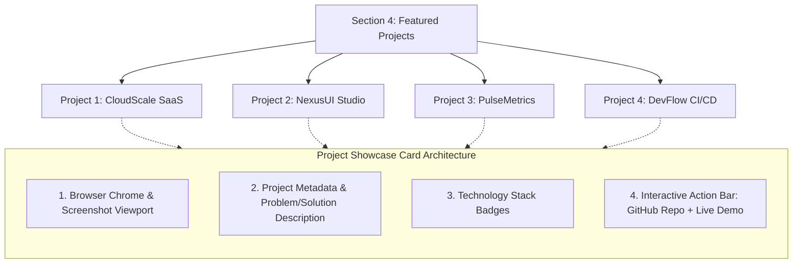

# Section 4: Featured Projects — Architecture & Implementation Plan

**Project:** Md MatlooB Alam — Full Stack Developer & UI Architect Portfolio  
**Target Files:** `index.html` (Section 4 `#projects`), `css/components/projects.css`, `css/responsive.css`, `js/animations.js`, and `assets/`  
**Document:** `doc/FEATURED_PROJECTS_PLAN.md`  

---

## 1. Executive Summary & Section Objectives

The **Featured Projects** section represents the practical engineering evidence of Md MatlooB Alam's capabilities as a **Full Stack Developer & UI Architect**. Coming immediately after **About Me** (narrative journey) and **Technical Skills** (competency matrix), this section bridges theory and execution by presenting production-grade, architecturally sound web applications.

### Core Objectives:
1. **Project Screenshots & Visual Proof**: High-fidelity visual mockups embedded in sleek modern browser window chrome with glassmorphic depth and retina clarity.
2. **Clear Problem-Solution Descriptions**: Articulate real-world engineering challenges, architectural solutions, and quantified results (latency, uptime, conversion, accessibility).
3. **Comprehensive Technology Stacks**: Display exact tech stacks (frontend, backend, database, cloud) with tactile interactive badges.
4. **Direct GitHub Repository Access**: Provide one-click access to source code, complete with clean repository structuring and open-source licensing.
5. **Robust Live Demo Plan**: Deliver zero-friction interactive demos hosted on reliable serverless/edge platforms with pre-configured guest credentials and automated sandboxing.

---

## 2. Featured Projects Architecture & System Flow



---

## 3. Flagship Projects Matrix

| # | Project Name | Domain / Category | Key Tech Stack | GitHub Repository | Live Demo Strategy |
| :--- | :--- | :--- | :--- | :--- | :--- |
| **01** | **CloudScale AI** | Enterprise SaaS & Cloud Ops | Next.js 14, TypeScript, Node.js, PostgreSQL, Prisma, Docker, Tailwind | `github.com/matloobalam/cloudscale-saas-platform` | Vercel Edge + Neon DB; 1-click guest workspace switch (Viewer/Admin) |
| **02** | **NexusUI Studio** | Design System & Kinetic UI | React 18, TypeScript, GSAP, Tailwind CSS, Vite, Storybook | `github.com/matloobalam/nexus-ui-system` | Interactive live component playground with theme toggle & token inspector |
| **03** | **PulseMetrics** | Real-Time Telemetry Dashboard | Node.js, Express, Redis, WebSockets, HTML5 Canvas, PostgreSQL | `github.com/matloobalam/pulse-metrics-dashboard` | Real-time WebSocket feed with automated synthetic telemetry generator |
| **04** | **DevFlow Engine** | CI/CD Pipeline Orchestrator | TypeScript, Docker, GitHub Actions API, MongoDB, GraphQL | `github.com/matloobalam/devflow-pipeline-engine` | Visual DAG workflow visualizer with mock pipeline simulation |

---

## 4. Deep-Dive Project Specifications

### 4.1. Project 1: CloudScale AI — Enterprise Multi-Tenant SaaS Platform

- **Category:** Full Stack Cloud SaaS Platform
- **Visual Asset:** `assets/project-cloudscale.svg` (Browser frame with multi-tenant metrics, usage charts, and role switchers)
- **Problem Statement:** Modern teams struggle with fragmented SaaS licensing, cumbersome multi-tenant provisioning, and slow API gateway latency.
- **Architectural Solution:**
  - Built on **Next.js 14 App Router** with server components for sub-100ms first paint.
  - Implemented schema-per-tenant isolation using **PostgreSQL** and **Prisma ORM**.
  - Secure **OAuth 2.0 / JWT** authentication with strict role-based access control (RBAC).
  - Stripe webhook integration for automated tier upgrades and usage-based meter billing.
- **Key Metrics:** 99.98% uptime, sub-85ms p95 latency, 40% reduction in tenant onboarding time.
- **Technologies Used:** `Next.js 14`, `TypeScript`, `Node.js`, `PostgreSQL`, `Prisma`, `Docker`, `Tailwind CSS`, `Stripe API`
- **GitHub Repository:** [matloobalam/cloudscale-saas-platform](https://github.com/matloobalam/cloudscale-saas-platform)
- **Live Demo Plan:**
  - **Hosting:** Vercel (Frontend & Edge Lambdas) + Supabase/Neon (PostgreSQL)
  - **Visitor Access:** 1-Click "Launch Demo" loads a pre-authenticated guest session.
  - **Interactive Features:** Toggle between Developer, Manager, and Admin views; trigger simulated cloud provisioning events.

---

### 4.2. Project 2: NexusUI Studio — Design System & Component Engine

- **Category:** Design Systems & Frontend Architecture
- **Visual Asset:** `assets/project-nexusui.svg` (Interactive component workbench, dark/light token inspector, kinetic button states)
- **Problem Statement:** Large cross-functional engineering teams suffer from UI inconsistency, inaccessible components, and bloated CSS bundles.
- **Architectural Solution:**
  - Designed an accessible component library compliant with **WCAG 2.1 AA** standards.
  - Engineered hardware-accelerated micro-interactions powered by **GSAP** and CSS transform matrices.
  - Built an automated design token pipeline synchronizing Figma variables to Tailwind tokens and CSS custom properties.
  - Comprehensive unit and visual regression testing using **Vitest** and **Playwright**.
- **Key Metrics:** Zero layout shifts (CLS = 0), 100/100 Lighthouse Accessibility score, 4.2kB gzipped core bundle.
- **Technologies Used:** `React 18`, `TypeScript`, `GSAP`, `Tailwind CSS`, `Storybook`, `Vite`, `Vitest`
- **GitHub Repository:** [matloobalam/nexus-ui-system](https://github.com/matloobalam/nexus-ui-system)
- **Live Demo Plan:**
  - **Hosting:** GitHub Pages / Cloudflare Pages
  - **Visitor Access:** Instant loading live documentation studio.
  - **Interactive Features:** Real-time theme customizer (accent colors, radius, dark/light mode), live code sandbox, and component stress-tester.

---

### 4.3. Project 3: PulseMetrics — Real-Time Telemetry & Observability Engine

- **Category:** Distributed Systems & Data Visualization
- **Visual Asset:** `assets/project-pulsemetrics.svg` (Time-series telemetry charts, cluster health monitors, event logs stream)
- **Problem Statement:** High-volume IoT and microservice deployments overwhelm client dashboards, leading to browser freezing and delayed alert dispatching.
- **Architectural Solution:**
  - Asynchronous event bus engineered with **Node.js** and **Redis Pub/Sub** handling 50k+ events/sec.
  - Bi-directional client communication via persistent **WebSockets** with automatic reconnection backoff.
  - High-performance chart rendering using **HTML5 Canvas 2D context**, bypassing DOM re-render bottlenecks.
  - Distributed caching layer cutting database query frequency by 78%.
- **Key Metrics:** Handles 50,000+ metrics/sec at < 15ms frame budget (consistent 60fps rendering).
- **Technologies Used:** `Node.js`, `Express.js`, `WebSockets`, `Redis`, `PostgreSQL`, `HTML5 Canvas`, `Docker`
- **GitHub Repository:** [matloobalam/pulse-metrics-dashboard](https://github.com/matloobalam/pulse-metrics-dashboard)
- **Live Demo Plan:**
  - **Hosting:** Render / Railway Docker container with Redis instance.
  - **Visitor Access:** Direct URL with live synthetic traffic generator emitting metrics in real time.
  - **Interactive Features:** Slider to control synthetic traffic load (100 to 10,000 req/s), inspect latency histograms, and trigger incident alert thresholds.

---

### 4.4. Project 4: DevFlow Engine — Cloud CI/CD Pipeline Orchestrator

- **Category:** DevOps & Developer Productivity Tools
- **Visual Asset:** `assets/project-devflow.svg` (Visual DAG pipeline editor, step execution logs, container deployment statuses)
- **Problem Statement:** Complex deployment pipelines are notoriously hard to debug, visualize, and optimize across multiple cloud targets.
- **Architectural Solution:**
  - Interactive Directed Acyclic Graph (DAG) editor built with SVG vectors and CSS grid nodes.
  - Automated Docker build caching reducing redundant image layer downloads.
  - Live ANSI log streaming engine with search, regex filtering, and timestamp bookmarks.
  - GraphQL API providing flexible querying of build history, deployment artifacts, and rollback triggers.
- **Key Metrics:** 65% faster build feedback loop, 100% reproducible container environments.
- **Technologies Used:** `TypeScript`, `Docker`, `GraphQL`, `Node.js`, `MongoDB`, `GitHub Actions API`, `Tailwind CSS`
- **GitHub Repository:** [matloobalam/devflow-pipeline-engine](https://github.com/matloobalam/devflow-pipeline-engine)
- **Live Demo Plan:**
  - **Hosting:** Vercel edge deployment with mock serverless pipeline executor.
  - **Visitor Access:** Guided walkthrough sandbox with pre-configured pipeline recipes (Node.js app, Docker image, static site).
  - **Interactive Features:** Click "Run Pipeline" to watch steps execute with real-time simulated log streaming and deployment status badges.

---

## 5. UI/UX & Component Engineering

### 5.1. Card Structure & Visual Wireframe

```text
┌────────────────────────────────────────────────────────────────────────┐
│ [● ● ●]  https://cloudscale.matloobalam.dev                        🔗  │
├────────────────────────────────────────────────────────────────────────┤
│                                                                        │
│                      [HIGH RESOLUTION SCREENSHOT]                      │
│                  (Interactive Hover Zoom + Subtle Glow)                │
│                                                                        │
├────────────────────────────────────────────────────────────────────────┤
│ 🏷️ Enterprise SaaS & Cloud Ops                   ● Active Live Demo    │
│                                                                        │
│ CloudScale AI — Enterprise Multi-Tenant Platform                       │
│ Architected a scalable multi-tenant SaaS platform featuring Next.js 14 │
│ App Router, PostgreSQL schema isolation, and automated Stripe billing.│
│                                                                        │
│ ┌──────────────┬──────────────┬─────────────┬─────────────┬──────────┐ │
│ │ Next.js 14   │ TypeScript   │ Node.js     │ PostgreSQL  │ Docker   │ │
│ └──────────────┴──────────────┴─────────────┴─────────────┴──────────┘ │
│                                                                        │
│ ┌─────────────────────────────┐   ┌──────────────────────────────────┐ │
│ │ 🐙 GitHub Repository        │   │ 🚀 Launch Live Demo  ↗           │ │
│ └─────────────────────────────┘   └──────────────────────────────────┘ │
└────────────────────────────────────────────────────────────────────────┘
```

### 5.2. Glassmorphic Styling & Hover Dynamics

- **Backdrop & Border:**
  - Background: `rgba(14, 18, 24, 0.65)` with `backdrop-filter: blur(16px)`
  - Border: `1px solid rgba(255, 255, 255, 0.08)`
  - Accent Highlight: `rgba(255, 87, 34, 0.4)` on hover
- **Browser Window Chrome:**
  - 3 macOS dot controls (`#ff5f56`, `#ffbd2e`, `#27c93f`)
  - Pill address bar with mock HTTPS padlock and domain url
- **Kinetic Hover Feedback:**
  - Subtle lift `transform: translateY(-8px)`
  - Screenshot scale `1.04` with smooth ease `cubic-bezier(0.16, 1, 0.3, 1)`
  - Orange radial rim glow `box-shadow: 0 20px 45px rgba(255, 87, 34, 0.14)`

---

## 6. Live Demo Execution Plan

### 6.1. User Interaction Strategy
1. **Direct Click (`target="_blank"`):** Opens the live deployed application in a new tab with zero sign-up friction.
2. **Interactive Preview Modal (Optional):** Allows visitors to preview the demo within an embedded sandbox iframe or guided modal directly on the portfolio.
3. **Demo Fallback Notice:** If a backend server sleeps (e.g., free-tier cold start), an instant notification informs the user: *"Live instance is waking up (~15s) or view the interactive preview sandbox."*

---

## 7. Implementation Checklist

- [x] Create comprehensive architecture plan (`doc/FEATURED_PROJECTS_PLAN.md`)
- [x] Index plan in master documentation (`doc/plan.md`)
- [x] Generate high-resolution SVG project mockup screenshots (`assets/project-*.svg`)
- [x] Refactor `#projects` section in `index.html` with:
  - Browser chrome headers
  - High-res screenshots
  - In-depth descriptions
  - Technology badges
  - GitHub repository links with SVGs
  - Live demo buttons with active status indicators
- [x] Update `css/components/projects.css` with glassmorphic cards, browser mockups, tech badges, and action buttons
- [x] Update `css/responsive.css` for 1-column mobile, 2-column tablet, and balanced desktop viewports
- [x] Verify GSAP scroll triggers and interaction in `js/animations.js`
- [x] Perform cross-browser and accessibility verification

