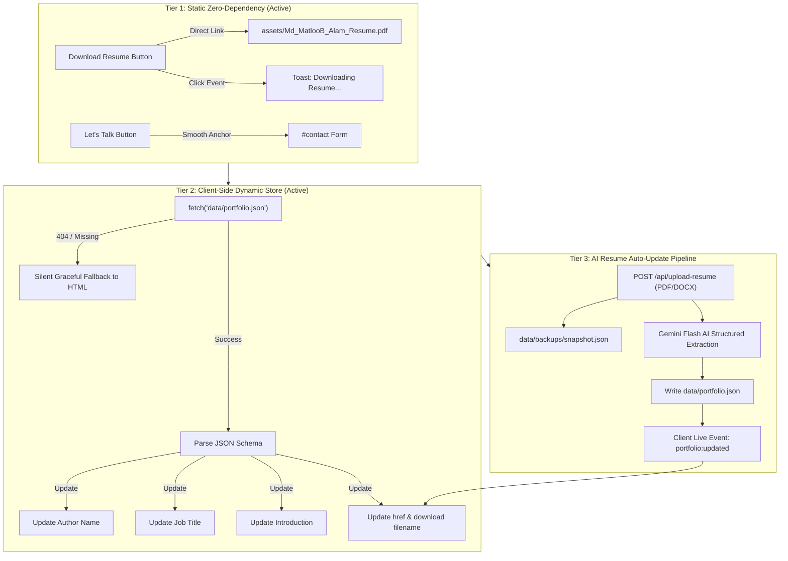

# Home Section Dynamic Architecture & Implementation Plan

**Project:** Md MatlooB Alam — Full Stack Developer & UI Engineer Portfolio  
**Target File:** `d:\Project\Protfolio\index.html` & `css/components/hero.css`  
**Document:** `doc/HOME_SECTION_DYNAMIC_PLAN.md`  

---

## 1. Executive Summary

This plan specifies the structural design, interactive components, responsive behavior, and dynamic state management for the **Home (Hero) Section** of the portfolio.

The Home Section serves as the primary visual and functional anchor for recruiters, clients, and technical peers. It balances an editorial dark glassmorphic design system with real-time opportunity status, professional identity, and dynamic Call-To-Action (CTA) triggers for resume downloads and contact acquisition.

---

## 2. Wireframe & Visual Composition

```text
┌────────────────────────────────────────────────────────────────────────────────────────┐
│ NAVBAR: [M Matloob.dev]      Home  About  Skills  Projects  Experience  [Get in touch ↗]│
├────────────────────────────────────────────────────────────────────────────────────────┤
│                                                                                        │
│  [🟢 Available for opportunities | Freelance & Full-time]                              │
│                                                                                        │
│  HELLO, I'M                                                                            │
│  Md MatlooB Alam                                      ┌──────────────────────────────┐ │
│  Full Stack Developer & UI Engineer                   │ ┌──────────────────────────┐ │ │
│                                                       │ │                          │ │ │
│  Specializing in engineering high-performance web     │ │   Professional Photo     │ │ │
│  applications, scalable cloud architectures, and      │ │   / Portrait Frame       │ │ │
│  intuitive digital interfaces. Turning complex        │ │   (Fallback to SVG)      │ │ │
│  challenges into sleek, production-ready code.        │ │                          │ │ │
│                                                       │ └──────────────────────────┘ │ │
│  ┌──────────────────┐  ┌────────────────┐             │ 🟢 Open to Work              │ │
│  │ ⬇ Download Resume│  │ Let's Talk  ↗  │             │ </> Full Stack & UI          │ │
│  └──────────────────┘  └────────────────┘             └──────────────────────────────┘ │
│                                                                                        │
├────────────────────────────────────────────────────────────────────────────────────────┤
│  #01 Frontend           #02 Backend            #03 UI/UX              #04 Cloud        │
│  Engineering            Systems                Design                 & DevOps         │
└────────────────────────────────────────────────────────────────────────────────────────┘
```

---

## 3. Core Component Specifications

### 3.1. Professional Photo Portrait
* **DOM Structure**: Located in `.hero-visual-block > .hero-photo-card`.
* **Ambient Lighting**: Outer `.hero-photo-glow` pseudo-element providing a `radial-gradient` diffusion with `#ff5722` orange glow.
* **Auto-Fallback Engine**:
  ```html
  
  ```
  * If `assets/profile.jpg` exists, the developer's real photograph is displayed with subtle smooth zoom on hover.
  * If `assets/profile.jpg` is not present, it gracefully falls back without broken image icons to `assets/profile-avatar.svg`.
* **Floating Micro-Badges**:
  * **Top Right**: `🟢 Open to Work` glass badge with glowing green indicator dot.
  * **Bottom Left**: `</> Full Stack & UI` monospace developer badge.

### 3.2. Name & Job Title Hierarchy
* **Greeting & Author Name**:
  * Greeting: `.hero-greeting-intro` ("HELLO, I'M") with uppercase orange accent typography.
  * Developer Name: `.hero-author-name` ("Md MatlooB Alam") in high-contrast crisp white typography.
* **Job Title**:
  * `.hero-main-title`: `Full Stack Developer & UI Engineer` with fluid clamp scaling (`clamp(2.8rem, 6vw, 4.8rem)`) and gradient text accent on the keyword `Developer`.

### 3.3. Short Introduction
* **Element**: `.hero-intro-text`
* **Content**: 
  > *"Specializing in engineering high-performance web applications, scalable cloud architectures, and intuitive digital interfaces. Turning complex challenges into sleek, production-ready code."*
* **Typography**: Fluid sizing `clamp(0.98rem, 1.15vw, 1.125rem)` with muted secondary text contrast (`var(--text-secondary)`) ensuring high readability across all screen sizes.

### 3.4. Available for Opportunities Indicator
* **Element**: `.hero-status-badge`
* **Live Radar Pulse**: Animated via `@keyframes pulseDotGreen` on `.status-pulse-dot` with emerald green hue (`#00e676`).
* **Dual Status Labels**:
  * Primary: `Available for opportunities`
  * Secondary: `Freelance & Full-time` (separated by a clean vertical glass border).

---

## 4. Dynamic Plan: Resume Download & Contact Buttons

The CTA system is architected across three synchronized tiers:



### 4.1. Resume Download Dynamic Lifecycle

1. **Static Fallback**:
   * Works immediately on static hosts (GitHub Pages, Vercel, Netlify) without a server.
   * Button markup includes `download="Md_MatlooB_Alam_Resume.pdf"` attribute to prompt the browser's native file download rather than navigating away.
2. **Interactive Micro-Interaction**:
   * On click, `js/main.js` catches the event and triggers `FormController.showToast()`:
     ```text
     "Downloading Md MatlooB Alam's Resume (PDF)..."
     ```
   * Provides immediate tactile feedback while the binary file streams to the user's device.
3. **Dynamic Path & Filename Binding (`portfolio.json`)**:
   * If `data/portfolio.json` contains:
     ```json
     {
       "profile": {
         "resumeUrl": "assets/Md_MatlooB_Alam_Resume.pdf",
         "resumeFilename": "Md_MatlooB_Alam_Senior_FullStack_Resume.pdf"
       }
     }
     ```
   * The client scripts automatically re-bind the button without editing raw HTML files.
4. **Integration with Resume Auto-Update Pipeline**:
   * When an updated resume is uploaded via the AI resume ingestion service (as detailed in `RESUME_AUTO_UPDATE_PLAN.md`), the server saves the new file, updates `portfolio.json`, and triggers a DOM re-render with the new timestamp and download link.

### 4.2. Contact Button Kinematics
* **Element**: `.hero-btn-contact`
* **Micro-Interaction**: Hovering moves the circular arrow icon `translateX(3px)` with smooth CSS timing.
* **Navigation**: Smoothly animates the viewport to `#contact` and focuses the name input field (`#userName`) for frictionless client inquiry.

---

## 5. Responsive Behavior Across Breakpoints

| Breakpoint | Layout Strategy | Photo Dimensions | Action Buttons |
| :--- | :--- | :--- | :--- |
| **Desktop (&gt; 1024px)** | 2-column flex (60% content / 40% photo) | 340px &times; 340px | Side-by-side flex row |
| **Tablet (768px &ndash; 1024px)** | Stacked column (Content top, Photo centered) | 300px &times; 300px | Side-by-side flex row |
| **Phablet &amp; Mobile (&le; 767px)** | Stacked column, centered alignments | 280px &times; 280px | Wrapped flex column / full width |
| **Small Mobile (&le; 480px)** | Compact typography, fluid buttons | 260px &times; 260px | Full width (`width: 100%`) buttons |

---

## 6. Maintenance & Asset Replacement Guide

1. **How to add your actual photo**:
   * Place your professional photo at:
     ```text
     d:\Project\Protfolio\assets\profile.jpg
     ```
   * Recommended dimensions: `800x800px` (square aspect ratio, JPG or WebP).
   * The website will instantly prioritize `profile.jpg` over `profile-avatar.svg`.

2. **How to update the resume PDF**:
   * Replace the PDF file at:
     ```text
     d:\Project\Protfolio\assets\Md_MatlooB_Alam_Resume.pdf
     ```
   * Any user clicking "Download Resume" will immediately receive the new PDF document.
