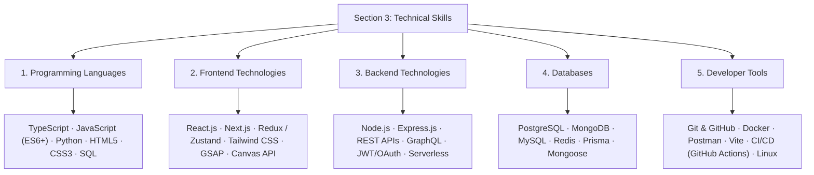

# Section 3: Technical Skills — Content Architecture & Implementation Plan

**Project:** Md MatlooB Alam — Full Stack Developer & UI Architect Portfolio  
**Target Files:** `index.html` (Section 3 `#skills`), `css/components/skills.css`, and `js/animations.js`  
**Document:** `doc/TECHNICAL_SKILLS_PLAN.md`  

---

## 1. Executive Summary & Section Objectives

The **Technical Skills** section serves as the core technical competency showcase of Md MatlooB Alam's portfolio. It transitions visitors from narrative identity (About Me) to hard engineering proof points.

### Primary Objectives:
1. **Accurate Categorization**: Group skills into 5 distinct, well-defined industry standard tiers:
   - **Programming Languages**
   - **Frontend Technologies**
   - **Backend Technologies**
   - **Databases**
   - **Developer Tools**
2. **Visual Hierarchy & Glassmorphism**: Align with the Folioblox Design System (`#030608` deep backdrop, `rgba(14, 18, 24, 0.55)` frosted cards, and `#ff5722` electric orange interactive accents).
3. **Information Density & Scannability**: Use categorized glassmorphic cards with dedicated category SVG icons, descriptive subtitles, and tactile pill badges that reveal mastery context on interaction.
4. **Performance & Accessibility**: Ensure semantic markup (`<section id="skills">`, `<article class="skill-card">`), zero layout shifts (CLS = 0), and accessible contrast (WCAG 2.1 AA).

---

## 2. Technical Skills Architecture & Breakdown



---

## 3. Detailed Category Specifications & Content Matrix

| Category | Icon / Visual Anchor | Core Technologies / Skills | Experience Level & Focus |
| :--- | :--- | :--- | :--- |
| **1. Programming Languages** | `<code />` Terminal SVG | • **TypeScript** (Strict Typing, Generics)<br>• **JavaScript** (ES6+, Async, DOM)<br>• **Python** (Data Handling, Scripting)<br>• **HTML5** (Semantic Web, ARIA)<br>• **CSS3** (Grid, Flexbox, Animations)<br>• **SQL** (Queries, Optimization) | Primary daily languages with emphasis on enterprise TypeScript and modern ECMAScript standards. |
| **2. Frontend Technologies** | `<layers />` Interface SVG | • **React.js** (Hooks, Context, SSR)<br>• **Next.js** (App Router, Server Actions)<br>• **Redux Toolkit / Zustand**<br>• **Tailwind CSS** (Utility-first styling)<br>• **GSAP & Motion** (ScrollTrigger, 60fps)<br>• **HTML5 Canvas** (Kinematic streams) | Building high-performance, pixel-perfect user interfaces, fluid animations, and scalable design systems. |
| **3. Backend Technologies** | `<server />` Cloud Server SVG | • **Node.js** (Runtime, Event Loop)<br>• **Express.js** (Modular routers, middleware)<br>• **RESTful APIs** (Architectural design)<br>• **GraphQL** (Queries & Mutations)<br>• **Authentication** (JWT, OAuth 2.0, bcrypt)<br>• **Microservices & Serverless** | Scalable REST & GraphQL services, secure token workflows, and resilient asynchronous server pipelines. |
| **4. Databases & Storage** | `<database />` Cylinders SVG | • **PostgreSQL** (Relational, Indexing)<br>• **MongoDB** (NoSQL, Aggregation)<br>• **MySQL** (Relational schemas)<br>• **Redis** (In-memory caching, pub/sub)<br>• **Prisma ORM** (Type-safe queries)<br>• **Mongoose** (ODM modeling) | Relational modeling, high-throughput caching, NoSQL flexibility, and automated migration management. |
| **5. Developer Tools & DevOps** | `<cpu />` / `<tool />` Terminal SVG | • **Git & GitHub** (PRs, Rebasing, Branching)<br>• **Docker** (Containerization, Compose)<br>• **Postman / Insomnia** (API testing)<br>• **Vite / Webpack** (Module bundling)<br>• **CI/CD Pipelines** (GitHub Actions)<br>• **Linux / Bash** (Environment orchestration) | Automated testing, containerization, modern build tooling, continuous integration, and cloud deployment. |

---

## 4. UI/UX & Visual Layout Design

### 4.1. Layout Grid Strategy
- **Grid Container**: `.skills-grid`
  - Flexible 5-card layout supporting 2 to 3 columns on desktop, 2 columns on tablet, and single-column stack on mobile:
    ```css
    grid-template-columns: repeat(auto-fit, minmax(320px, 1fr));
    ```
  - For wide desktop displays (≥ 1200px), a featured 3-top / 2-bottom or dynamic 5-column balanced layout ensures natural symmetry.

### 4.2. Card Anatomy (`.skill-card`)
Each card is built with the glassmorphism design standard:
1. **Header Block (`.skill-card-top`)**:
   - **Icon Container (`.skill-icon-wrap`)**: 48×48px with `var(--accent-orange-subtle)` backdrop, neon orange border (`rgba(255, 87, 34, 0.3)`), and clean SVG icon.
   - **Title & Badge**: Category heading (`h3.skill-category-title`) + count indicator badge (e.g. `6 Technologies`).
2. **Category Description (`.skill-category-desc`)**:
   - 1-2 sentence engineering summary highlighting how the technologies are applied.
3. **Skills Chip Cloud (`.skill-pills`)**:
   - High-contrast interactive chips (`.skill-pill`) with subtle glow on hover, micro-icon, and tool name.
   - Interactive hover lift: `transform: translateY(-2px);` with `box-shadow: 0 4px 14px rgba(255, 87, 34, 0.25);`.

### 4.3. Visual Wireframe

```text
┌────────────────────────────────────────────────────────────────────────────────────────┐
│ SECTION 3: SKILLS & TECHNOLOGY STACK                                                   │
│ [Core Capabilities]                                                                    │
│ Tools, languages, and frameworks leveraged to build world-class products.              │
├───────────────────────────────────┬──────────────────────────────────┬─────────────────┤
│ ┌───────────────────────────────┐ │ ┌──────────────────────────────┐ │ ┌─────────────┐ │
│ │ </> Programming Languages (6) │ │ │ 💻 Frontend Technologies (6) │ │ │ ⚡ Backend    │ │
│ │ Typescript · Javascript ·     │ │ │ React · Next.js · Redux ·    │ │ │ Node · REST │ │
│ │ Python · HTML5 · CSS3 · SQL   │ │ │ Tailwind · GSAP · Canvas     │ │ │ Express ... │ │
│ └───────────────────────────────┘ │ └──────────────────────────────┘ │ └─────────────┘ │
├───────────────────────────────────┴───┬──────────────────────────────┴─────────────────┤
│ ┌───────────────────────────────────┐ │ ┌────────────────────────────────────────────┐ │
│ │ 🗄️ Databases & Storage (6)        │ │ │ 🛠️ Developer Tools & DevOps (6)            │ │
│ │ PostgreSQL · MongoDB · MySQL ·    │ │ │ Git · Docker · Postman · Vite · CI/CD ·    │ │
│ │ Redis · Prisma · Mongoose         │ │ │ Linux & Terminal Workflows                 │ │
│ └───────────────────────────────────┘ │ └────────────────────────────────────────────┘ │
└────────────────────────────────────────────────────────────────────────────────────────┘
```

---

## 5. Responsive Breakpoint Plan

| Breakpoint Tier | Width | Grid & Element Adaptations |
| :--- | :--- | :--- |
| **Desktop / Ultrawide** | `≥ 1200px` | 3 cards in row 1, 2 cards centered/balanced in row 2 (or 3+2 grid arrangement). Pill spacing 8px. |
| **Laptop / Compact Desktop** | `992px – 1199px` | 2 cards per row with equal height stretch; last card spans comfortably or auto-balances. |
| **Tablet** | `768px – 991px` | 2 columns with reduced card padding (`var(--space-5)`). Touch-friendly tap targets. |
| **Mobile Portrait** | `< 768px` | 1 single-column stack. Pills wrap naturally with 44px+ minimum touch hit target. Icon wrap scales to 40×40px. |

---

## 6. Implementation Checklist & Step-by-Step Execution

- [ ] **Step 1: HTML Semantic Restructuring (`index.html`)**
  - Update `#skills` section markup to house 5 distinct `<article class="glass-card skill-card">` containers.
  - Insert clean SVG vector icons for each category:
    1. Code bracket icon for **Programming Languages**.
    2. Layers / Monitor icon for **Frontend Technologies**.
    3. Server racks icon for **Backend Technologies**.
    4. Database cylinder icon for **Databases**.
    5. Terminal / Tool wrench icon for **Developer Tools**.
  - Add counter badges and tech pill tags for all 5 categories.

- [ ] **Step 2: Component Stylesheet Enhancements (`css/components/skills.css`)**
  - Refine grid layout rules with auto-fit layout or staggered 3/2 desktop arrangement.
  - Add pill tag interactive styling with micro-dot status or subtle icon indicators.
  - Add smooth transition easing (`cubic-bezier(0.16, 1, 0.3, 1)`).

- [ ] **Step 3: Animation & Scroll Trigger Integration (`js/animations.js`)**
  - Register `.skill-card` elements in the GSAP / IntersectionObserver scroll reveal sequence.
  - Stagger card reveal with `0.1s` delay between items for cinematic entrance.

- [ ] **Step 4: Verification & Cross-Device Testing**
  - Check contrast ratio across all pills and titles against `#030608` background.
  - Verify mobile responsiveness and keyboard focus outlines (`:focus-visible`).

