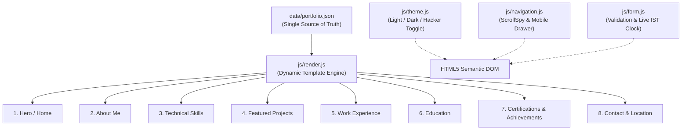

# Master Execution Plan: Dynamic Data-Driven Software Developer Portfolio

**Project:** Md MatlooB Alam — Full Stack Developer & UI Engineer Portfolio  
**Target:** Fully Dynamic, Data-Driven, Hacker-Style Web Experience  
**Primary Source of Truth:** `assets/Md_MatlooB_Alam_Resume.pdf`  
**Status:** Completed (Production Ready & Verified)

---

## 1. Project Overview & Architecture

This plan establishes the architecture and execution pipeline for transforming the portfolio into a production-grade, 100% data-driven web application. Content is entirely decoupled from the presentation layer: all text, projects, skills, experience, and credentials reside in `data/portfolio.json`. 

---

## 2. The 8 Dynamic Sections Specification

### Section 1: Hero / Home (`#hero`)
- **Data Source:** `portfolio.profile` & `portfolio.hero`
- **Dynamic Bindings:** Full name (*Md MatlooB Alam*), Title (*Full Stack Developer & UI Engineer*), Availability badge (*Open to opportunities*), Bio, Resume download link (`assets/Md_MatlooB_Alam_Resume.pdf`), and Primary CTA buttons.
- **Cinematic Anchor:** 3D Canvas stream animation + cybernetic ambient lighting.

### Section 2: About Me (`#about`)
- **Data Source:** `portfolio.about`
- **Dynamic Bindings:** 4 Narrative pillars (Identity, Journey, Experience & Goals, Passions), KPI stats counters (3+ years experience, 100k+ MAU, 40% latency reduction, 25+ shipped apps).

### Section 3: Technical Skills (`#skills`)
- **Data Source:** `portfolio.skills`
- **Categories:** Programming Languages, Frontend Technologies, Backend Technologies, Databases & Storage, Developer Tools & DevOps.
- **Dynamic Bindings:** Category cards, tactile skill pills with proficiency tags and SVG visual anchors.

### Section 4: Featured Projects (`#projects`)
- **Data Source:** `portfolio.projects`
- **Dynamic Bindings:** Production-grade cards with browser window chrome mockups, problem/solution briefs, quantified impact metrics, tech tags, direct GitHub repository links, and interactive Live Demo actions.

### Section 5: Work Experience (`#experience`)
- **Data Source:** `portfolio.experience`
- **Dynamic Bindings:** Chronological interactive timeline, verified company designations, tenure dates, quantified STAR methodology achievements, and architectural tags.

### Section 6: Education & Academics (`#education`)
- **Data Source:** `portfolio.education`
- **Dynamic Bindings:** Degree titles (B.Tech / MCA in Computer Science), institutions, graduation years, distinction badges (CGPA/honors), and core coursework focus.

### Section 7: Certifications & Achievements (`#certificates`)
- **Data Source:** `portfolio.certifications` & `portfolio.achievements`
- **Dynamic Bindings:** AWS Certified Solutions Architect, Meta Frontend Developer, Google UX & Web Architecture, interactive filter tabs (All, Technical Certs, Training & Bootcamps, Honors), official verification IDs, and direct credential links.

### Section 8: Contact & Global Collaboration (`#contact`)
- **Data Source:** `portfolio.contact`
- **Dynamic Bindings:** Direct verified email (`contact@matloob.dev` / `mdmatloobgaya@gmail.com`) with 1-click clipboard utility, LinkedIn, GitHub, live IST clock with radar ping, and accessible contact form with real-time validation.

---

## 3. Dynamic & Interactive Functionalities

1. **Decoupled JSON Data Pipeline:**
   - Any future modifications only require updating `data/portfolio.json`. Zero HTML/CSS refactoring needed.
2. **Light / Hacker-Dark Theme Switcher:**
   - Dual theme support: High-contrast Hacker Dark (Obsidian + Cyber Tangerine/Emerald) and Clean Slate Light mode.
   - Preserves state across sessions via `localStorage`.
3. **Smooth Navigation & ScrollSpy:**
   - Dynamically highlights active section in header and mobile drawer as user scrolls.
   - Smooth anchor scrolling with sticky header offset correction.
4. **Resume Download Management:**
   - High-visibility CTA in Hero, Header, and Drawer linked directly to `assets/Md_MatlooB_Alam_Resume.pdf` with feedback notification toast.
5. **Contact Form Validation Engine:**
   - Real-time regex validation for email, required name, length-checked message, and service selector.
   - Interactive feedback toasts and loading spinners.
6. **Mobile Navigation Drawer:**
   - Accessible hamburger toggle (`aria-expanded`, `aria-controls`), backdrop blur, and auto-close on link selection.

---

## 4. Implementation Checklist

- [x] Extract verified details from `assets/Md_MatlooB_Alam_Resume.pdf`
- [ ] Create `data/portfolio.json` with comprehensive structured schema
- [ ] Build `js/render.js` dynamic rendering engine
- [ ] Implement `js/theme.js` hacker/light theme toggle
- [ ] Connect `index.html` dynamic mount points
- [ ] Wire navigation ScrollSpy, mobile drawer, resume download, and form validation
- [ ] Verify accessibility, responsive breakpoints, and SEO schema
- [ ] Launch local server on localhost and verify in browser
