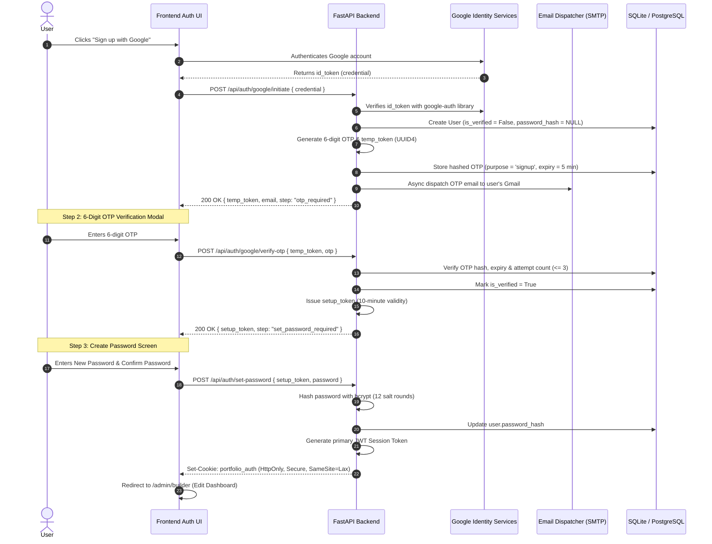
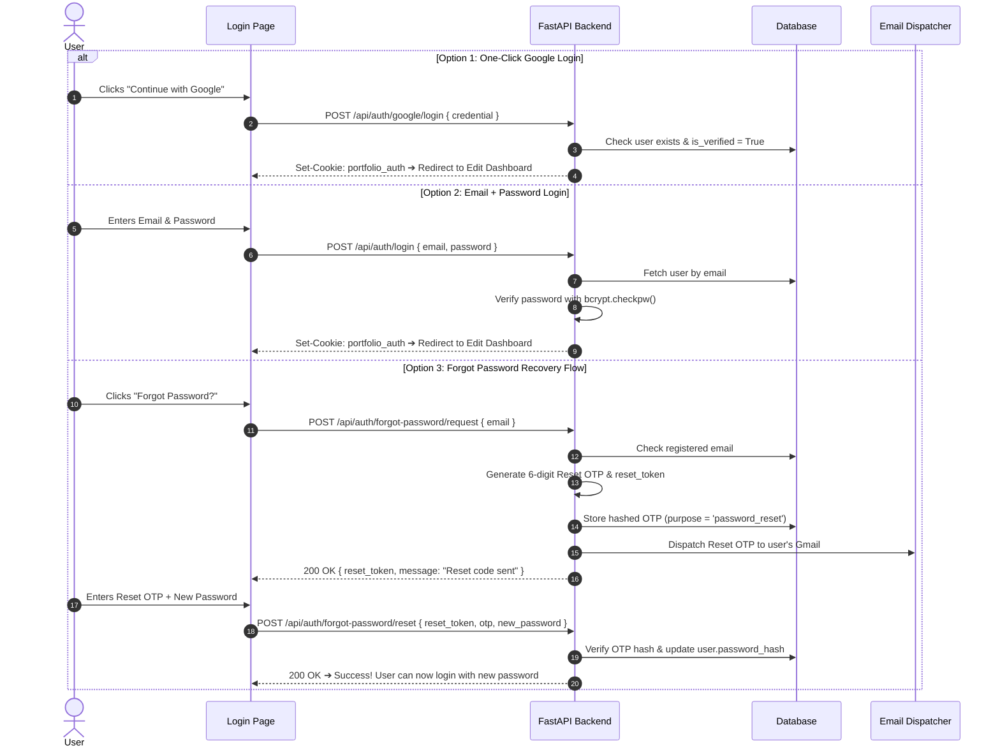

# Complete Architectural Plan: Google Authentication, Email OTP, Password Setup, Dual Login & Split-Screen Edit Dashboard

> **Project**: Folioblox Dynamic Portfolio & AI Engine  
> **Author**: Antigravity Engineering  
> **Status**: Ready for Implementation  
> **Target Stack**: FastAPI (Python), SQLAlchemy (SQLite/PostgreSQL), Vanilla JS / Tailwind / Glassmorphism UI, Google Identity Services (GIS), SMTP / Resend  

---

## 1. Executive Summary & Flow Architecture

Is architecture ka maqsad ek secure, modern aur user-friendly authentication and management ecosystem provide karna hai:

```
[1. Google Sign-Up] 
        ⬇
[2. 6-Digit Email OTP Verification] ➔ Sent to user's Google Gmail (5 min expiry)
        ⬇
[3. Create New Password] ➔ User sets a strong password (Bcrypt hashed)
        ⬇
[4. Account Activated!] ➔ Access to Edit Dashboard
        ⬇
[5. Subsequent Logins] ➔ Option A: 1-Click Google Login  OR  Option B: Email + Password
        ⬇
[6. Forgot Password?] ➔ Reset OTP via Email ➔ Set New Password
        ⬇
[7. Edit Dashboard] ➔ Left: Form Editor  |  Right: Real-Time Live Preview
```

---

## 2. Visual UI Design References

Hamne is flow ke liye 3 high-fidelity UI visual mockups render kiye hain:

1. **Google Sign-In & 6-Digit OTP Verification Modal**:  
   `google_signup_otp_modal_mockup.jpg`  
   - Glassmorphic popup, 6 individual input boxes, 60s cooldown timer.

2. **Password Setup Modal & Dual Login Screen**:  
   `auth_ui_flow_mockup.jpg`  
   - "Create Your Password" with live strength meter + "Continue with Google" vs "Email/Password" login options with "Forgot Password?" link.

3. **Split-Screen Edit Dashboard with Real-Time Live Preview**:  
   `portfolio_builder_saas_dashboard.jpg`  
   - Left side Form Editor (Bio, Skills, Projects, Theme) aur right side 1:1 Live Preview with "Synced" status pill.

---

## 3. End-to-End Sequence Diagrams

### A. Google Sign-Up ➔ OTP Verification ➔ Password Creation



---

### B. Subsequent Dual Login & Forgot Password Recovery



---

## 4. Database Schema Specifications (`server_py/models.py`)

Hum do key tables add karenge:

```python
from datetime import datetime, timezone
from sqlalchemy import Column, Integer, String, Boolean, DateTime, ForeignKey, Text
from sqlalchemy.orm import relationship
from server_py.database import Base

def utc_now():
    return datetime.now(timezone.utc)

class User(Base):
    """
    User Account Table.
    Supports both Google OAuth identification and bcrypt password authentication.
    """
    __tablename__ = "users"

    id = Column(Integer, primary_key=True, index=True)
    google_sub = Column(String(255), unique=True, index=True, nullable=True) # Linked Google Sub ID
    email = Column(String(255), unique=True, index=True, nullable=False)
    password_hash = Column(String(255), nullable=True)                      # Bcrypt hash (NULL until set)
    name = Column(String(255), nullable=True)
    avatar_url = Column(String(1024), nullable=True)
    role = Column(String(50), default="admin")                              # Role: 'admin' / 'user'
    is_verified = Column(Boolean, default=False)                            # Verified via OTP
    created_at = Column(DateTime, default=utc_now)
    last_login = Column(DateTime, nullable=True)

    otps = relationship("EmailOTP", back_populates="user", cascade="all, delete-orphan")

    def has_password(self) -> bool:
        return self.password_hash is not None


class EmailOTP(Base):
    """
    OTP Verifications Table.
    Handles 'signup' OTP and 'password_reset' OTP securely.
    """
    __tablename__ = "email_otps"

    id = Column(Integer, primary_key=True, index=True)
    user_id = Column(Integer, ForeignKey("users.id", ondelete="CASCADE"), nullable=False)
    otp_hash = Column(String(255), nullable=False)                           # SHA-256 salted hash
    token = Column(String(255), unique=True, index=True, nullable=False)     # temp_token or reset_token
    purpose = Column(String(32), default="signup")                           # 'signup' or 'password_reset'
    attempts_count = Column(Integer, default=0)                              # Max 3 attempts
    is_used = Column(Boolean, default=False)
    expires_at = Column(DateTime, nullable=False)                           # 5 minutes validity
    created_at = Column(DateTime, default=utc_now)

    user = relationship("User", back_populates="otps")
```

---

## 5. Backend REST API Contract (`server_py/auth_routes.py`)

| Endpoint | HTTP Method | Request Body | Response (Success) | Description |
| :--- | :---: | :--- | :--- | :--- |
| `/api/auth/google/initiate` | `POST` | `{"credential": "<id_token>"}` | `{"status": "otp_required", "temp_token": "...", "email": "..."}` | Google token verify karke user banata hai aur OTP bhejta hai. |
| `/api/auth/google/verify-otp` | `POST` | `{"temp_token": "...", "otp": "482915"}` | `{"status": "set_password_required", "setup_token": "..."}` | OTP verify karta hai aur password set karne ka token deta hai. |
| `/api/auth/set-password` | `POST` | `{"setup_token": "...", "password": "..."}` | `{"status": "success", "user": {...}}` + Set Cookie | Password bcrypt karke DB me save karta hai aur JWT cookie issue karta hai. |
| `/api/auth/login` | `POST` | `{"email": "...", "password": "..."}` | `{"status": "success", "user": {...}}` + Set Cookie | Email + Password standard login. |
| `/api/auth/google/login` | `POST` | `{"credential": "<id_token>"}` | `{"status": "success", "user": {...}}` + Set Cookie | 1-Click Google login for existing verified users. |
| `/api/auth/forgot-password/request`| `POST` | `{"email": "..."}` | `{"status": "otp_sent", "reset_token": "..."}` | Password reset ke liye 6-digit OTP email bhejta hai. |
| `/api/auth/forgot-password/reset` | `POST` | `{"reset_token": "...", "otp": "...", "new_password": "..."}` | `{"status": "password_updated"}` | Reset OTP verify karke naya password update karta hai. |
| `/api/auth/me` | `GET` | Cookie / Auth Header | `{"authenticated": true, "user": {...}}` | Current login session check karta hai. |
| `/api/auth/logout` | `POST` | None | `{"status": "logged_out"}` + Clear Cookie | User session terminate karta hai. |

---

## 6. Comprehensive Phase-Wise Implementation Plan

Neeche har phase ka complete roadmap, file-level tasks, input/output requirements, aur verification checklist detailed di gayi hai:

| Phase | Phase Title | Primary Focus | Output / Milestone | Status |
| :---: | :--- | :--- | :--- | :---: |
| **Phase 1** | **Environment & Dependencies** | Google Cloud Client ID, SMTP Setup, Python Libraries | Config ready in `.env` & `requirements.txt` | ⏳ Pending |
| **Phase 2** | **Database Schema & Models** | `User` (password support) & `EmailOTP` (multi-purpose) | Tables created in SQLite / PostgreSQL | ⏳ Pending |
| **Phase 3** | **Security & Async Email Dispatcher** | Bcrypt hashing, 6-digit OTP generator, HTML email | SMTP sends OTP in background | ⏳ Pending |
| **Phase 4** | **Backend REST API Endpoints** | Signup, OTP verify, Set Password, Dual Login, Forgot PW | 9 FastAPI endpoints live on `/api/auth` | ⏳ Pending |
| **Phase 5** | **Frontend UI & Interactive Modals** | Google button, 6-box OTP modal, Set/Forgot Password | Complete glassmorphic auth flow UI | ⏳ Pending |
| **Phase 6** | **Edit Dashboard & Route Protection** | Auth guard, user session sync, live preview bridge | Full integration with Portfolio Editor | ⏳ Pending |

---

### 🔹 Phase 1: Environment & Dependencies Setup
* **Objective**: Google OAuth 2.0 Client credentials aur Email Dispatcher (SMTP) ko configure karna.
* **Target Files**:
  - `requirements.txt`
  - `.env` & `.env.example`
  - `server_py/config.py`
* **Tasks Checklist**:
  - [ ] Add Python packages to `requirements.txt`:
    ```txt
    google-auth>=2.28.0
    bcrypt>=4.1.2
    passlib>=1.7.4
    pyjwt>=2.8.0
    aiosmtplib>=3.0.1
    ```
  - [ ] Add environment keys in `.env`:
    - `GOOGLE_CLIENT_ID`: Google OAuth 2.0 Web Client ID
    - `JWT_SECRET_KEY`: Cryptographic signing secret
    - `SMTP_HOST`: `smtp.gmail.com` (ya Resend / SendGrid)
    - `SMTP_PORT`: `587`
    - `SMTP_USER`: Sender Gmail address
    - `SMTP_PASSWORD`: 16-character Gmail App Password
    - `MAIL_FROM`: Display email address
  - [ ] Update `server_py/config.py` to parse and export these environment configurations.
* **Verification**: `python -c "import google.auth, bcrypt, jwt, aiosmtplib; print('Dependencies OK')"` runs with exit code 0.

---

### 🔹 Phase 2: Database Schema & Migration
* **Objective**: User accounts, password hashes, aur OTP records store karne ke liye tables create karna.
* **Target Files**:
  - `server_py/models.py`
  - `server_py/database.py`
  - `server_py/seed_db.py`
* **Tasks Checklist**:
  - [ ] Define `User` table:
    - `id`: Integer Primary Key
    - `google_sub`: Google Subject ID (String, unique, index)
    - `email`: User Email (String, unique, index)
    - `password_hash`: Bcrypt hashed password (String, nullable)
    - `name`: User Display Name (String)
    - `avatar_url`: User Profile Picture (String)
    - `role`: Role (`admin` / `user`)
    - `is_verified`: Boolean (False until OTP verification)
    - `created_at` & `last_login`: Timestamps
  - [ ] Define `EmailOTP` table:
    - `id`: Integer Primary Key
    - `user_id`: Foreign Key to `users.id`
    - `otp_hash`: Salted SHA-256 hash
    - `token`: Unique Session/Reset Token (UUID4)
    - `purpose`: String (`'signup'` or `'password_reset'`)
    - `attempts_count`: Integer (Max 3 attempts)
    - `is_used`: Boolean (False)
    - `expires_at`: Timestamp (5 minutes validity)
  - [ ] Update database startup lifecycle so that tables are auto-created without losing portfolio data.
* **Verification**: Run `python -c "from server_py.database import engine, Base; from server_py.models import User, EmailOTP; Base.metadata.create_all(bind=engine); print('Tables Verified')"`

---

### 🔹 Phase 3: Core Security Engine & Email Dispatcher
* **Objective**: Cryptographic security utilities aur async HTML email sender module build karna.
* **Target Files**:
  - `server_py/auth_security.py`
  - `server_py/mailer.py`
* **Tasks Checklist**:
  - [ ] **Password Security**:
    - `hash_password(raw_password: str) -> str`: Bcrypt with salt.
    - `verify_password(raw_password: str, hashed_password: str) -> bool`: Constant-time check.
  - [ ] **OTP Security**:
    - `generate_secure_otp() -> str`: 6-digit random code using `secrets.randbelow(1_000_000)`.
    - `hash_otp(otp: str) -> str`: SHA-256 hash.
    - `verify_otp(raw_otp: str, hashed_otp: str) -> bool`.
  - [ ] **JWT Token Management**:
    - `create_jwt_token(payload: dict, expires_minutes: int) -> str`.
    - `decode_jwt_token(token: str) -> dict`.
  - [ ] **Async HTML Email Templates (`server_py/mailer.py`)**:
    - Build Template 1: *Google Sign-Up OTP Verification* (Modern glassmorphic email with 6-digit glowing code card & 5-minute expiry warning).
    - Build Template 2: *Forgot Password Recovery OTP* (Security alert with 6-digit reset code).
    - Send emails asynchronously via `FastAPI.BackgroundTasks` so API response latency is < 50ms.
* **Verification**: Run a standalone test script to deliver a sample OTP email to the developer's inbox.

---

### 🔹 Phase 4: Backend REST API Endpoints Implementation
* **Objective**: Frontend ke sath communicate karne ke liye complete authentication router implement karna.
* **Target Files**:
  - `server_py/auth_routes.py`
  - `app.py`
* **Tasks Checklist**:
  - [ ] **Endpoint 1: `POST /api/auth/google/initiate`**
    - Verifies Google `id_token` via `google.oauth2.id_token.verify_oauth2_token`.
    - Checks or creates unverified `User` record.
    - Generates 6-digit OTP, stores hash in `email_otps`, and dispatches email.
    - Returns `{"status": "otp_required", "temp_token": "...", "email": "..."}`.
  - [ ] **Endpoint 2: `POST /api/auth/google/verify-otp`**
    - Verifies 6-digit OTP against `email_otps`.
    - Enforces max 3 wrong attempts & 5-minute expiry.
    - Marks user `is_verified = True`.
    - Returns `{"status": "set_password_required", "setup_token": "..."}`.
  - [ ] **Endpoint 3: `POST /api/auth/set-password`**
    - Accepts `setup_token` and `new_password`.
    - Hashes password using Bcrypt and saves to `user.password_hash`.
    - Issues `portfolio_auth` HttpOnly JWT Cookie.
  - [ ] **Endpoint 4: `POST /api/auth/login` (Email + Password)**
    - Verifies credentials using Bcrypt hash.
    - Issues `portfolio_auth` HttpOnly JWT Cookie.
  - [ ] **Endpoint 5: `POST /api/auth/google/login` (1-Click Google Login)**
    - For already registered & verified users.
    - Verifies Google token, matches email, issues session cookie directly.
  - [ ] **Endpoint 6: `POST /api/auth/forgot-password/request`**
    - Accepts registered email, dispatches 6-digit Password Reset OTP.
  - [ ] **Endpoint 7: `POST /api/auth/forgot-password/reset`**
    - Verifies Reset OTP and updates `user.password_hash` with the new password.
  - [ ] **Endpoint 8 & 9: `GET /api/auth/me` & `POST /api/auth/logout`**
    - Session status check & cookie revocation.
  - [ ] Mount auth router in `app.py`: `app.include_router(auth_router, prefix="/api/auth", tags=["Authentication"])`.
* **Verification**: Swagger UI (`http://localhost:8000/docs`) me saare endpoints test karna.

---

### 🔹 Phase 5: Frontend UI & Interactive Modals
* **Objective**: Modern, dark glassmorphism authentication UI create karna with smooth animations.
* **Target Files**:
  - `index.html` (Modal markup)
  - `js/auth.js` (Frontend auth logic)
  - `css/auth-modal.css` (Glassmorphism styling)
* **Tasks Checklist**:
  - [ ] **Dual Login Screen**:
    - Official Google Identity Services SDK (`accounts.google.com/gsi/client`).
    - Custom styled Google Sign-In button.
    - Divider line: `— OR CONTINUE WITH EMAIL —`.
    - Email & Password input fields with sleek icons.
    - Cyan clickable link: `"Forgot Password?"`.
    - Gradient action button: `"Sign In to Dashboard"`.
  - [ ] **6-Digit OTP Verification Modal**:
    - 6 individual inputs: `[ 4 ] [ 8 ] [ 2 ] [ · ] [ · ] [ · ]`.
    - Auto-advance on keystroke, auto-retreat on backspace.
    - Full clipboard paste support (Ctrl+V paste 6 digits automatically).
    - Real-time 60-second cooldown timer (*"Resend code in 00:45"*).
  - [ ] **"Create Your Password" Modal**:
    - Step banner: *"Google Account Verified: user@gmail.com"*.
    - Password & Confirm Password input fields with show/hide eye toggle.
    - Interactive real-time Password Strength Bar (Weak / Medium / Strong).
  - [ ] **"Forgot Password" Modal**:
    - Step 1: Enter email -> Submit.
    - Step 2: Enter 6-digit Reset OTP + New Password -> Confirm.
* **Verification**: Browser me signup flow test karna: Google popup -> OTP input -> Password creation -> Success.

---

### 🔹 Phase 6: Edit Dashboard Integration & Route Protection
* **Objective**: Successful login ke baad user ko live Split-Screen Form Editor me land karana aur secure karna.
* **Target Files**:
  - `server_py/auth_security.py` (`get_current_active_user` dependency)
  - `app.py`
  - `js/dashboard.js`
* **Tasks Checklist**:
  - [ ] Backend route protection: Sensitive portfolio update APIs (`/api/portfolio/publish`, `/api/upload-resume`) ko JWT cookie verify karne wali dependency se protect karna.
  - [ ] Post-login redirection:
    - Sahi login hote hi window user ko `/admin` ya portfolio edit modal par automatically redirect karegi.
  - [ ] Split-Screen Editor Header Integration:
    - User profile avatar aur email badge top navigation bar me display hona.
    - "Logout" action button jo session cookie clear kare aur home page par bhej de.
* **Verification**: Without valid cookie, edit/publish APIs block hongi (`401 Unauthorized`), aur login ke baad split-screen editor seamlessly access hoga.

---

## 7. Security & Anti-Abuse Standards

| Security Requirement | Implementation Detail |
| :--- | :--- |
| **Password Storage** | Bcrypt with 12 computational rounds. Plaintext password memory se immediately clear ho jata hai. |
| **OTP Storage** | Salted SHA-256 hash. Plaintext OTP database me kabhi persist nahi hota. |
| **Brute Force Lockout** | Max 3 incorrect attempts. 3 galat attempts ke baad OTP record invalidate ho jata hai. |
| **Expiration Control** | OTP exactly 300 seconds (5 minutes) baad expire ho jata hai. |
| **Email Throttling** | Resend endpoint par 60 seconds ka cooldown timer enforced hai. |
| **Session Protection** | Session token `localStorage` me save karne ke bajaye **HttpOnly, Secure, SameSite=Lax** cookies me store hota hai (XSS proof). |

---

## 8. Verification & Test Plan

1. **Test 1: Full Google Sign-Up & Password Setup**
   - Click Google Sign-in -> Receive OTP email -> Enter OTP -> Enter new password `MySecurePass@123` -> Redirect to Edit Dashboard.
2. **Test 2: Dual Login Check**
   - Logout.
   - Test Login A: Enter same Gmail + password `MySecurePass@123` -> Successfully log in.
   - Logout.
   - Test Login B: Click "Continue with Google" -> Successfully log in without entering password.
3. **Test 3: Forgot Password Flow**
   - Click "Forgot Password?" -> Enter Gmail -> Receive Reset OTP -> Enter Reset OTP + New Password `NewPass@456` -> Login with `NewPass@456`.
4. **Test 4: Security Throttling Check**
   - Enter wrong OTP 3 times -> Ensure session gets blocked with `400 Too Many Attempts`.
